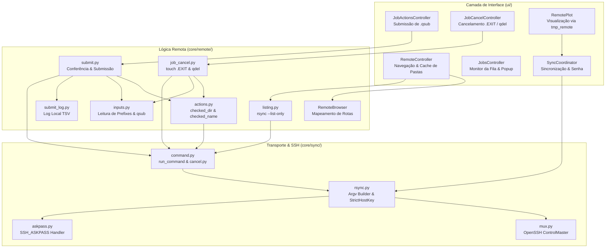

# Relatório de Análise Técnica: Modo Remoto, Conexão com o Cluster e Segurança no Lain

**Data:** 2026-10-27  
**Base:** `main` (após a integração da spec 72 — multiplexação SSH)  
**Escopo:** Módulos de conexão remota, transporte e sincronização (`core/remote/`, `core/sync/`, `core/cluster_jobs.py`) e controladores de interface gráfica associados (`ui/remote_controller.py`, `ui/job_actions.py`, `ui/job_cancel.py`, `ui/jobs_controller.py`, `ui/sync_coordinator.py`).  
**Documentos de Referência:** `specs/Archived/spec_64` a `spec_72`, `CLAUDE.md`, relatórios prévios em `Documentation/Relatorios/`.

---

## 1. Sumário Executivo e Metodologia

Este relatório apresenta uma auditoria completa de **engenharia de software, arquitetura de sistemas, robustez operacional e segurança defensiva** do Modo Remoto e dos subsistemas de interação com clusters HPC no Lain (QE Studio).

### 1.1. Metodologia de Investigação
1. **Análise Estática de Código e Fluxo de Dados:** Inspeção manual detalhada de caminhos de execução, tratamento de erros, concorrência entre threads, ciclo de vida de subprocessos e protocolos de comunicação sobre SSH.
2. **Auditoria de Segurança:** Avaliação de vetores de injeção de comandos, travessia de diretórios (*path traversal*), exposição de credenciais em memória/processos, integridade de sockets Unix e políticas de verificação de chaves públicas.
3. **Execução da Suíte de Testes:** Execução e validação de 191 testes unitários remotos, 104 testes de interface gráfica (PyQt6) e 26 testes de integração SSH contra o servidor de mock local (`tests/ssh_server.py` em paramiko), todos passando com 100% de sucesso.
4. **Verificação de Tipos e Estilo:** Conformidade com `pyright` (modo basic, 0 erros) e `ruff` (conformidade total com regras de lint e formatação).

---

## 2. Visão Geral da Arquitetura

O Lain adota uma separação estrita entre a lógica de negócios e conexão (`core/`) e a interface gráfica em PyQt6 (`ui/`), fiscalizada de forma automatizada por `tests/test_architecture.py`.



### 2.1. Organização dos Módulos
- **`core/remote/`**: Funções síncronas e bloqueantes destinadas a serem executadas estritamente em workers (`TaskGroup`). Constrói comandos remotos, analisa saídas de agendadores e mantém o estado da sessão de navegação (`RemoteBrowser`).
- **`core/sync/`**: Camada de baixo nível responsável pela construção de argumentos do `rsync` e `ssh`, gerenciamento de variáveis de ambiente (`child_env`), injeção de senhas sem exibição em argv (`SSH_ASKPASS`), e controle de conexões multiplexadas (`mux.py`).
- **`ui/`**: Controladores que orquestram a interface gráfica, despacham tarefas para pools de threads dedicados e garantem que o loop de eventos Qt permaneça fluido e responsivo.

### 2.2. Modelo de Concorrência e Isolamento de Tarefas
Para evitar contenção e travamentos de interface, o Lain utiliza pools de threads independentes (`QThreadPool`) configurados por responsabilidade:
1. **Listagem Remota (`RemoteController`):** Pool próprio com até 2 threads. Permite que a expansão de pastas na árvore (`RemoteTreePanel`) e a exibição de arquivos na grade (`RemoteFilePanel`) operem em paralelo. Navegações rápidas cancelam cooperativamente tarefas anteriores via `self._tasks.cancel(folder)`.
2. **Ações no Cluster (`JobActionsController` e `JobCancelController`):** Pool próprio com exatamente 1 thread. Garante que operações de submissão e cancelamento sejam estritamente serializadas, impedindo condições de corrida na fila do cluster.
3. **Monitoramento de Jobs (`JobsController`):** Pool próprio com 1 thread dedicado exclusivamente ao polling periódico do `cluster.jobs_command`.
4. **Sincronização de Arquivos (`SyncCoordinator`):** Executa processos isolados via `QProcess` (`core/sync/_process.py`).

### 2.3. Multiplexação SSH (`ControlMaster`)
Introduzida pela spec 72, a multiplexação reduz o tempo de cada comando no cluster de ~1,65 s (handshake completo + auth) para ~0,25 s:
- O primeiro processo `ssh` para a conta atua como mestre (`ControlMaster=auto`).
- O socket Unix é armazenado em `control_dir()` sob a máscara `0700`.
- O caminho do socket é particionado por PID (`<pid>-%C`), garantindo que cada instância em execução do Lain gerencie seus próprios mestres sem interferir em outras instâncias.
- Ao fechar a janela, o encerramento ordenado (`ui/shutdown.py`) executa `ssh -O stop -S <socket> localhost`, finalizando os mestres de forma limpa.

---

## 3. Auditoria de Segurança

A arquitetura de segurança do Lain no modo remoto foi projetada com fortes mecanismos de defesa em profundidade:

### 3.1. Gestão de Credenciais e Autenticação
- **Autenticação por Chave (`auth: key`):** O método primário e recomendado. Utiliza `BatchMode=yes` e `IdentitiesOnly=yes` quando uma chave explícita é fornecida (`cluster.key_path`). Chaves com passphrase dependem do `ssh-agent` do usuário.
- **Autenticação por Senha (`auth: password`):**
  - A senha nunca é passada na linha de comando (`argv`), evitando exposição em comandos como `ps aux` ou `/proc/<pid>/cmdline`.
  - A senha reside na memória do processo principal (`SyncCoordinator._session_password`) e é transferida para o subprocesso exclusivamente via variável de ambiente `QE_STUDIO_ASKPASS_SECRET`.
  - Um executável wrapper (`askpass.sh` gerado em `cache_dir()`) executa `python -m qe_studio.core.sync.askpass "$@"`, lendo o segredo do ambiente do filho e escrevendo-o no stdout para o `ssh`.
  - **Avaliação de Risco:** No Linux, o ambiente `/proc/<pid>/environ` é protegido e acessível apenas pelo próprio usuário (mesmo UID) e pelo `root`. Com a multiplexação SSH ativa, o processo mestre retém a variável de ambiente em seu processo enquanto estiver vivo (até 120 s após o último comando). Este comportamento é documentado e um risco aceito inerente ao uso de `ControlMaster` com senhas.

### 3.2. Verificação de Chave de Host (*Host Key Verification*)
- O Lain força incondicionalmente `-o StrictHostKeyChecking=yes` em todas as invocações de SSH geradas em `core/sync/rsync.py:86`. Essa diretiva na linha de comando sobrepõe qualquer configuração permissiva que o usuário possua em seu `~/.ssh/config`.
- No helper `askpass.py`, qualquer prompt de confirmação de host desconhecido contendo `"yes/no"` é respondido compulsoriamente com `"no"` (`print("no")`).
- **Conclusão:** É matematicamente impossível ocorrer aceitação tácita de chaves não confiáveis. Ataques de *Man-in-the-Middle* (MitM) que tentem forjar a identidade do cluster são sumariamente bloqueados. O usuário deve conectar ao cluster ao menos uma vez fora do Lain para validar a chave em `~/.ssh/known_hosts`.

### 3.3. Proteção contra Injeção de Comandos Remotos
Comandos remotos executados via `ssh user@host "command"` são interpretados pelo shell de login do usuário remoto. O Lain adota regras excepcionalmente rígidas para evitar injeções:
- **Identificadores de Scripts e Arquivos:** Submetidos a validação por whitelist expressa em `core/remote/actions.py:31`:
  ```python
  SAFE_NAME = re.compile(r"^[A-Za-z0-9_][A-Za-z0-9._+-]*$")
  ```
  Qualquer caractere como espaços, ponto-e-vírgula, aspas, acentos, crases ou substituições de comando (`$()`) gera uma exceção imediata `ValueError`.
- **Identificadores de Jobs:** O cancelamento via `qdel` valida o ID estritamente contra números inteiros via `_ID = re.compile(r"^\d+$")` (`job_cancel.py:44`).
- **Confinamento de Caminhos (*Path Traversal*):** A função `checked_dir` valida se o caminho é descendente direto de `paths.remote_root` via `PurePosixPath.is_relative_to()`. Além disso, como cada segmento do caminho passa por `checked_name()`, caracteres de travessia como `..` são rejeitados na raiz.
- **Comandos Fixos:** Apenas os binários configurados em `config.yaml` (`jobs_command`, `submit_command`, `delete_command`) e comandos de sistema fixos e auditados (`cd`, `chmod a+x`, `touch`) são executados.

---

## 4. Diagnóstico de Bugs, Casos de Borda e Limitações

A auditoria identificou **8 pontos de atenção técnica**, classificados por severidade e esforço:

| ID | Severidade | Área | Problema | Impacto | Esforço |
|---|---|---|---|---|---|
| **B1** | **Média** | SSH Mux | Falha no fallback de `control_dir` quando `XDG_RUNTIME_DIR` excede 34 bytes | Multiplexação desativada silenciosamente | P |
| **B2** | **Média** | Segurança | Janela TOCTOU de permissões na criação do `askpass.sh` | Leitura temporária de script em sistemas multi-usuário | P |
| **B3** | **Média** | Cancelamento | Impossibilidade de cancelar cálculos sem inputs SCF/Relax/VC-Relax (ex: nscf, bands, ph.x) | Bloqueio total de cancelamento pelo app | M |
| **B4** | **Baixa** | Compatibilidade | Rigidez do parser `qstatus` e regex de data | Incompatibilidade com formatos ISO e agendadores não-SGE | M |
| **B5** | **Baixa** | Resiliência | Processo mestre SSH congelado após queda de conexão | Congelamento repetido de 40 s nas requisições seguintes | P |
| **B6** | **Baixa** | Usabilidade | Bloqueio de pastas com espaços, acentos ou parênteses | Impossibilidade de submeter/cancelar em pastas nomeadas informalmente | P |
| **B7** | **Baixa** | Navegação | Links simbólicos de diretórios marcados como não-navegáveis | Inacessibilidade de volumes via symlink (ex: /scratch) | M |
| **B8** | **Baixa** | Sincronização | Falta de limite de tamanho agregado no plot scratch (`tmp_remote/`) | Risco de download maciço sem confirmação prévia | P |

---

### B1 · Falha no Fallback de `control_dir` quando `XDG_RUNTIME_DIR` é Longo
- **Localização:** `src/qe_studio/core/sync/mux.py:53-60`
- **Descrição do Código:**
  ```python
  runtime = os.environ.get("XDG_RUNTIME_DIR", "")
  if runtime and os.path.isabs(runtime):
      return _prepared(os.path.join(runtime, FOLDER), create)
  name = f"{FOLDER}-{os.getuid()}"
  base = os.path.join(tempfile.gettempdir(), name)
  if _too_long(base):
      base = os.path.join(FALLBACK_TMP, name)
  return _prepared(base, create)
  ```
- **Causa-Raiz:** `_prepared` verifica se o caminho excede `MAX_DIR_BYTES = 34`. Se exceder, retorna `None`. No entanto, na linha 55, o retorno de `_prepared(os.path.join(runtime, FOLDER), create)` é devolvido imediatamente! Se o caminho for longo (por exemplo, `/run/user/10002345/qe-studio-mux`, com 35 bytes), ele retorna `None` e o bloco de fallback (linhas 56-60, que usaria `/tmp/qe-studio-mux-<uid>`) **nunca é executado**.
- **Impacto:** Em sistemas Linux com UIDs longos ou onde `XDG_RUNTIME_DIR` aponta para pastas com nomes extensos, a multiplexação é completamente desativada sem qualquer mensagem ao usuário, degradando o desempenho para conexões lentas de SSH simples.

---

### B2 · Janela TOCTOU de Permissões no Helper `askpass.sh`
- **Localização:** `src/qe_studio/core/sync/rsync.py:109-115`
- **Descrição do Código:**
  ```python
  wrapper = cache_dir() / "askpass.sh"
  content = f'#!/bin/sh\nexec {shlex.quote(sys.executable)} -m qe_studio.core.sync.askpass "$@"\n'
  if not wrapper.exists() or wrapper.read_text() != content:
      wrapper.parent.mkdir(parents=True, exist_ok=True)
      wrapper.write_text(content)
      wrapper.chmod(stat.S_IRWXU)
  return str(wrapper)
  ```
- **Causa-Raiz:** `write_text()` cria o arquivo aplicando a `umask` padrão do sistema (normalmente `022`, resultando em permissão `0644`). Somente na linha subsequente o arquivo é restrito para `0700` (`stat.S_IRWXU`).
- **Impacto:** Em estações de trabalho multi-usuário onde `~/.cache` esteja permissivo, existe uma janela temporal onde outro usuário local poderia inspecionar ou tentar substituir o script de wrapper antes da aplicação da máscara estrita.

---

### B3 · Impossibilidade de Cancelar Jobs que Não Sejam SCF, Relax ou VC-Relax
- **Localização:** `src/qe_studio/core/remote/inputs.py:42`, `src/qe_studio/core/remote/job_cancel.py:126-132` e `src/qe_studio/core/remote/job_cancel.py:168-173`
- **Descrição do Código:**
  ```python
  STOP_CALCULATIONS = ("scf", "relax", "vc-relax")
  ```
  Se a pasta contiver uma simulação de bandas (`calculation = 'bands'`), `nscf` ou cálculo de propriedades via `ph.x` / `projwfc.x`, `fetch_stop_sources` não encontra nenhum prefix elegível e retorna vazio. Em `plan_stop`:
  ```python
  if not sources:
      return NotRunning(_("Nenhum input de scf, relax ou vc-relax do pw.x (até 1 MB) nesta pasta..."))
  ```
  Simultaneamente, ao tentar cancelar pelo botão do popup da fila, `waiting_check` bloqueia a operação:
  ```python
  if any(other.job_id == job.job_id for other in snapshot.running):
      message = _("O job {job_id} começou a rodar: o qdel não é usado em jobs em execução...")
      return Refused(message.format(job_id=job.job_id))
  ```
- **Impacto:** O usuário fica preso em um impasse operacional: a pasta recusa a criação do `.EXIT` porque não é SCF/relax, e a fila recusa o `qdel` porque o job está rodando. O usuário é obrigado a abrir um terminal externo SSH para cancelar o job manualmente.

---

### B4 · Rigidez de Agendador e Formatação de Datas em `core/cluster_jobs.py`
- **Localização:** `src/qe_studio/core/cluster_jobs.py:32-37, 88-102`
- **Causa-Raiz:**
  - `_DATE = re.compile(r"^\d{1,2}/\d{1,2}/\d{4}$")` aceita estritamente datas no formato `D/M/YYYY`. Se o cluster exibir datas em padrão ISO (`YYYY-MM-DD`), formato com traço (`DD-MM-YYYY`) ou texto abreviado (`Oct 27`), o parser descarta a linha.
  - O regex `_SUBMITTED = re.compile(r'^Your job (\d+) \("(.*)"\) has been submitted')` é exclusivo do SGE. Outros agendadores como Slurm (`Submitted batch job 1234`) ou PBS não são reconhecidos.
- **Impacto:** Em clusters com configurações regionais ligeiramente diferentes ou agendadores distintos, o Lain exibe "Jobs indisponíveis" ou "Resposta não reconhecida", desativando os bloqueios de segurança contra submissões duplicadas.

---

### B5 · Processo Mestre SSH Congelado após Queda Abrupta de Rede
- **Localização:** `src/qe_studio/core/sync/command.py:75-78` e `src/qe_studio/core/sync/mux.py`
- **Causa-Raiz:** Em `run_command`, quando expira o tempo limite (`cluster.connect_timeout + EXTRA_SECONDS`), `_kill(proc)` executa `os.killpg(proc.pid, signal.SIGKILL)` sobre o processo cliente do `ssh`. No entanto, o processo mestre SSH desacoplado continua existindo e segurando o socket Unix até que o keepalive (`ServerAliveInterval * ServerAliveCountMax = 45s`) detecte a perda de pacotes TCP.
- **Impacto:** Comandos emitidos logo após a falha conectam-se ao mesmo socket do mestre zumbi e travam por mais 40 segundos, gerando lentidão extrema percebida pelo usuário.

---

### B6 · Bloqueio Excessivo de Pastas por Caracteres Especiais
- **Localização:** `src/qe_studio/core/remote/actions.py:31, 57-65, 68-78`
- **Causa-Raiz:** `SAFE_NAME = re.compile(r"^[A-Za-z0-9_][A-Za-z0-9._+-]*$")`. O objetivo declarado é garantir compatibilidade caso o cluster utilize shells incomuns como `tcsh` ou `csh`. No entanto, pastas com espaços (ex: `calculo 1`), parênteses (ex: `slab_Pb(111)`) ou caracteres acentuados são totalmente recusadas por `checked_dir`.
- **Impacto:** O usuário visualiza os arquivos na árvore e na grade sem problemas (pois o rsync suporta esses nomes), mas ao tentar clicar em "Submeter…" ou "Cancelar simulação…", o item é desabilitado com mensagem de erro.

---

### B7 · Links Simbólicos de Diretórios Não Navegáveis no Modo Cluster
- **Localização:** `src/qe_studio/core/remote/listing.py:54-61, 97-107`
- **Causa-Raiz:** `RemoteEntry(..., link: bool = False)` define `is_dir = mode.startswith("d")`. Como um link simbólico tem `mode.startswith("l")`, `is_dir` é marcado como `False`. A decisão original buscou evitar loops infinitos no rsync.
- **Impacto:** Em sistemas HPC, é prática quase universal criar symlinks na *home* apontando para diretórios de cálculo em discos de alta velocidade (`/scratch`, `/work`). No Lain, esses links são tratados como arquivos estáticos e o usuário não consegue abri-los.

---

### B8 · Transferência sem Limite Agregado em Plot Scratch (`tmp_remote/`)
- **Localização:** `src/qe_studio/core/sync/controller.py:113-123`
- **Causa-Raiz:** `_use_scratch_plan` só exibe diálogo de prévia e confirmação se a propriedade `plan.large` for verdadeira, a qual verifica apenas se **algum arquivo individual** excede `100 MB` (`LARGE_FILE_BYTES`).
- **Impacto:** Uma simulação contendo 40 arquivos de 50 MB cada (total de 2.0 GB) não possui nenhum arquivo isolado > 100 MB. Ao clicar em "Plotar", o download de 2.0 GB é disparado imediatamente sem qualquer tela de confirmação de transferência de volume agregado.

---

## 5. Soluções e Melhorias Recomendadas

A seguir, apresentam-se as propostas de solução detalhadas, incluindo trechos de código e planos de implementação:

### S1 · Correção do Fallback de `control_dir` (Solução para B1)
Modificar `core/sync/mux.py` para que uma falha por tamanho excessivo em `XDG_RUNTIME_DIR` prossiga naturalmente para o fallback em `/tmp`:

```python
def control_dir(create: bool = True) -> Path | None:
    if sys.platform == "win32":
        return None
    runtime = os.environ.get("XDG_RUNTIME_DIR", "")
    if runtime and os.path.isabs(runtime):
        path = _prepared(os.path.join(runtime, FOLDER), create)
        if path is not None:
            return path
    name = f"{FOLDER}-{os.getuid()}"
    base = os.path.join(tempfile.gettempdir(), name)
    if _too_long(base):
        base = os.path.join(FALLBACK_TMP, name)
    return _prepared(base, create)
```

---

### S2 · Criação Segura e Atômica do Helper `askpass.sh` (Solução para B2)
Modificar `core/sync/rsync.py:askpass_program` para criar o arquivo com descritor de modo estrito `0700` diretamente, eliminando a janela TOCTOU:

```python
def askpass_program() -> str:
    if sys.platform == "win32":
        exe = Path(sys.executable).with_name("qe-studio-askpass.exe")
        scripts = Path(sys.executable).parent / "Scripts" / "qe-studio-askpass.exe"
        return str(exe if exe.exists() else scripts)
    wrapper = cache_dir() / "askpass.sh"
    content = f'#!/bin/sh\nexec {shlex.quote(sys.executable)} -m qe_studio.core.sync.askpass "$@"\n'
    if not wrapper.exists() or wrapper.read_text(encoding="utf-8") != content:
        wrapper.parent.mkdir(parents=True, exist_ok=True)
        # Criação segura com modo 0700 desde a origem
        flags = os.O_WRONLY | os.O_CREAT | os.O_TRUNC
        fd = os.open(wrapper, flags, 0o700)
        with open(fd, "w", encoding="utf-8") as f:
            f.write(content)
    return str(wrapper)
```

---

### S3 · Suporte a Cancelamento com Fallback Seguro para `qdel` (Solução para B3)
Para resolver o impasse de cálculos não-SCF:
1. Permitir a extração de `prefix` também de cálculos `nscf` e `bands` caso utilizem o `pw.x` (o `pw.x` respeita `.EXIT` em qualquer modo de cálculo).
2. Quando a pasta não contiver nenhum arquivo de input do `pw.x` (por exemplo, cálculos isolados de `ph.x` ou scripts gerais), o diálogo de cancelamento deve oferecer uma opção explícita de **Interrupção Forçada via `qdel`**, com alerta de perigo (CAUTION):
   > *"Esta pasta não possui inputs reconhecidos do pw.x para parada limpa via .EXIT. Deseja forçar o encerramento do processo no escalonador via qdel? Arquivos de saída em gravação podem ser corrompidos."*

---

### S4 · Recuperação e Limpeza de Sockets SSH Travados (Solução para B5)
Em `core/sync/mux.py`, implementar função de inspeção de saúde do mestre. Se um comando expirar com timeout de rede:
```python
def check_or_prune_socket(socket_path: Path, ssh_binary: str) -> bool:
    """Verifica se o mestre responde; se estiver travado, remove o socket órfão."""
    try:
        res = subprocess.run(
            [*shlex.split(ssh_binary), "-O", "check", "-S", str(socket_path), "localhost"],
            stdin=subprocess.DEVNULL, stdout=subprocess.DEVNULL, stderr=subprocess.DEVNULL,
            timeout=2.0, check=False,
        )
        return res.returncode == 0
    except subprocess.TimeoutExpired:
        log.warning("ssh mux: mestre travado no socket %s; forçando encerramento", socket_path)
        subprocess.run(
            [*shlex.split(ssh_binary), "-O", "stop", "-S", str(socket_path), "localhost"],
            stdin=subprocess.DEVNULL, stdout=subprocess.DEVNULL, stderr=subprocess.DEVNULL,
            timeout=1.0, check=False,
        )
        with contextlib.suppress(OSError):
            socket_path.unlink(missing_ok=True)
        return False
```

---

### S5 · Checagem de Tamanho Total Acumulado em Scratch (Solução para B8)
Ajustar `SyncPlan` em `core/sync/planner.py` para calcular tanto `large_file` quanto `large_total`:
```python
TOTAL_SCRATCH_LIMIT_BYTES = 200 * 1024 * 1024  # 200 MB agregado

@property
def requires_confirmation(self) -> bool:
    total_bytes = sum(item.size for item in self.items)
    return self.large or total_bytes > TOTAL_SCRATCH_LIMIT_BYTES
```

---

### S6 · Poda e Rotação Automática de `submitted_jobs.log` (Solução para B9)
Em `core/remote/submit_log.py`, ao registrar um novo job via `record()`, expurgar linhas cujo `date_utc` seja mais antigo que 60 dias:
```python
CUTOFF_SECONDS = 60 * 86400  # 60 dias

def prune_old_entries(entries: list[Logged], now_utc: float) -> list[Logged]:
    kept = []
    for entry in entries:
        try:
            t = calendar.timegm(time.strptime(entry.date_utc, "%Y-%m-%dT%H:%M:%SZ"))
            if now_utc - t < CUTOFF_SECONDS:
                kept.append(entry)
        except ValueError:
            kept.append(entry)
    return kept
```

---

## 6. Recomendações de Evolução e Roadmap

1. **Abstração do Agendador (Driver Pattern):**
   - Atualmente, a inteligência de fila e submissão está fortemente acoplada ao SGE (`qsub`, `qstat`, `qdel`).
   - Recomenda-se criar uma interface `SchedulerDriver` com implementações para `SGE`, `Slurm` (`sbatch`, `squeue`, `scancel`) e `PBS/Torque`. O tipo de agendador poderia ser detectado automaticamente ou configurado em `cluster.scheduler: "auto" | "sge" | "slurm"`.
2. **Navegação Segura em Symlinks:**
   - Adicionar ao `list_remote` a resolução de links (`rsync --copy-unsafe-links` ou inspeção via SSH). Se o destino do link for um diretório contido dentro de `paths.remote_root`, marcá-lo como `is_dir = True`, permitindo navegação transparente pelo usuário sem violar o confinamento do sandbox.
3. **Tratamento de Nomes com Espaços via Escape Seguro:**
   - Em vez de rejeitar terminantemente nomes que não casam com `SAFE_NAME`, permitir espaços e parênteses desde que submetidos a `shlex.quote()` robusto, mantendo a proibição estrita de caracteres de controle como `\n`, `\r`, `;`, `&`, `|` e `$`.

---

## 7. Conclusão

O subsistema de Conexão com o Cluster e Modo Remoto do Lain apresenta um **nível exemplar de rigor arquitetural e segurança defensiva**, destacando-se pela separação estrita de threads, validação estrita de entradas, recusa peremptória de vulnerabilidades de injeção de shell e adoção bem-sucedida de multiplexação SSH OpenSSH.

Os problemas identificados neste relatório concentram-se principalmente em **casos de borda de compatibilidade (agendadores e formatos de data), limitações em diretórios de multiplexação longos e rigidez excessiva em cancelamentos de jobs que não sejam pw.x SCF**. A adoção das soluções S1 a S6 propostas proporcionará maior resiliência e comodidade aos pesquisadores sem abrir mão de nenhuma das garantias de segurança já consolidadas.
