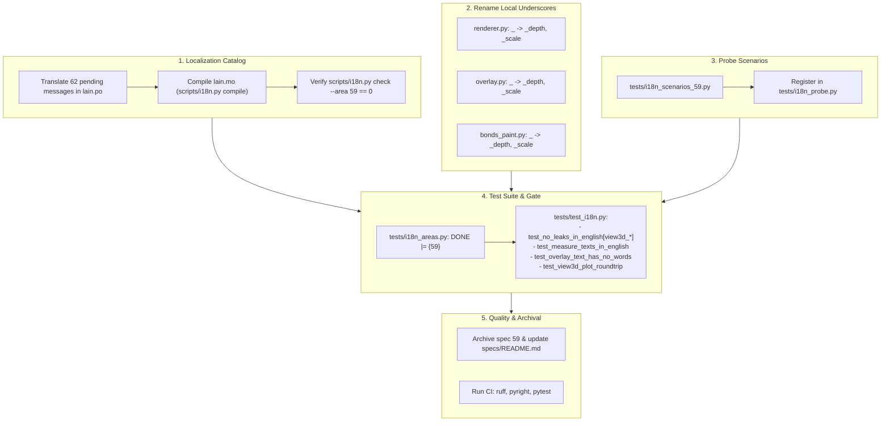

# Implementation Plan - Spec 59: Inglês da Visualização 3D

## Goal Description

Implement **Spec 59** (`specs/spec_59-i18n-visualizacao-3d.md`), which localizes the 3D structure visualization subsystem into English:
- The 3D window, top toolbar ("Resetar vista", "Vista" menu, "Print" action, status bar).
- The left accordion panel ("Estrutura", "Átomo", "Medidas", "Exibição", "Rotação", "Espécies", "Célula", and footer "Restaurar padrões").
- The measurements section, table headers, actions ("Copiar", "Limpar", "Apagar"), status feedback ("Medidas copiadas"), and TSV clipboard export (`to_tsv`).
- The atom detail panel, labels, properties, and bonded neighbor table.
- Print error messages and status notices.
- Preservation of internal data IDs in `view3d.plot` (`"vareta"`, `"fio"`, `"nenhum"`, `"simbolo"`, `"indice"`, `"ambos"`, `"escuro"`, `"claro"`, `"distancia"`, `"angulo"`).
- Renaming local throwaway `_` unpack variables in `renderer.py`, `overlay.py`, and `bonds_paint.py` to prevent variable shadowing if `_()` is ever imported there.
- Adding leak probe scenarios for area 59 in `tests/i18n_scenarios_59.py` and registering them in `tests/i18n_probe.py`.
- Adding automated tests in `tests/test_i18n.py` covering leak checks, TSV measurement output in English, painter painted text verification (no Portuguese word leak), and `view3d.plot` language invariance.
- Closing area 59 in `tests/i18n_areas.py` (`DONE = {53, 54, 55, 56, 57, 58, 59}`).
- Archiving Spec 59 and updating the roadmap.



---

## User Review Required

> [!IMPORTANT]
> **Decisions from Spec 59 to confirm:**
> 1. **TSV vs CSV export language**:
>    - The measurements TSV copied via "Copiar" follows the UI language (`Measure\tAtoms\tValue` and `Distance`/`Angle` in English), while numbers and units (`1.500 Å`, `109.50°`) remain identical in both languages.
>    - This contrasts with plot CSV exports (Spec 55) which remain fixed in Portuguese because they are saved to disk for external tools.
> 2. **Render style terminology**:
>    - `Vareta` → `Stick`
>    - `Fio` → `Wire`
>    - `Bola e vareta` → `Ball and stick`
>    - `Espaço cheio` → `Space filling`
> 3. **Labels & backgrounds terminology**:
>    - `Nenhum` / `Símbolo` / `Número` / `Ambos` → `None` / `Symbol` / `Number` / `Both`
>    - `Escuro` / `Claro` → `Dark` / `Light`
>    - `Distância` / `Ângulo` → `Distance` / `Angle`
>    - `Rotação` → `Rotation`
>    - `Apagar` → `Delete`
>    - `Print` → `Print`
>    - `Restaurar padrões` → `Restore defaults`
> 4. **Chemical elements translation**:
>    - The 118 chemical elements in `core/structure3d/elements.py` will be translated to standard English names (Hydrogen, Helium, Lithium, ... Oganesson).

---

## Open Questions

None. All requirements, decisions, and constraints are clearly specified in Spec 59 and aligned with previous i18n specs (52 through 58).

---

## Proposed Changes

### 1. Structure3D Widgets - Local Underscore Renaming

Renaming throwaway `_` unpack variables to avoid shadowing `_()` if gettext is imported in the future.

#### [MODIFY] [renderer.py](file:///home/m/Projetos/Lain/src/qe_studio/ui/widgets/structure3d/renderer.py)

- Line 257: `cxy, cdepth, _ = camera.project(...)` → `cxy, cdepth, _scale = camera.project(...)`
- Line 262: `axy, adepth, _ = camera.project(...)` → `axy, adepth, _scale = camera.project(...)`
- Line 384: `xy, _, scale = camera.project(...)` → `xy, _depth, scale = camera.project(...)`

#### [MODIFY] [overlay.py](file:///home/m/Projetos/Lain/src/qe_studio/ui/widgets/structure3d/overlay.py)

- Line 118: `tips, _, _ = camera.project(...)` → `tips, _depth, _scale = camera.project(...)`

#### [MODIFY] [bonds_paint.py](file:///home/m/Projetos/Lain/src/qe_studio/ui/widgets/structure3d/bonds_paint.py)

- Line 99: `start_xy, _, start_scale = camera.project(...)` → `start_xy, _depth, start_scale = camera.project(...)`
- Line 100: `end_xy, _, end_scale = camera.project(...)` → `end_xy, _depth, end_scale = camera.project(...)`
- Line 101: `_, middle_depth, _ = camera.project(...)` → `_xy, middle_depth, _scale = camera.project(...)`

---

### 2. Localization Catalog & Glossary

#### [MODIFY] [lain.po](file:///home/m/Projetos/Lain/src/qe_studio/locale/en/LC_MESSAGES/lain.po)
- Translate all 62 pending messages of Area 59:
  1. `Hidrogênio Hélio Lítio ... Oganessônio` → `Hydrogen Helium Lithium Beryllium Boron Carbon Nitrogen Oxygen Fluorine Neon Sodium Magnesium Aluminium Silicon Phosphorus Sulfur Chlorine Argon Potassium Calcium Scandium Titanium Vanadium Chromium Manganese Iron Cobalt Nickel Copper Zinc Gallium Germanium Arsenic Selenium Bromine Krypton Rubidium Strontium Yttrium Zirconium Niobium Molybdenum Technetium Ruthenium Rhodium Palladium Silver Cadmium Indium Tin Antimony Tellurium Iodine Xenon Caesium Barium Lanthanum Cerium Praseodymium Neodymium Promethium Samarium Europium Gadolinium Terbium Dysprosium Holmium Erbium Thulium Ytterbium Lutetium Hafnium Tantalum Tungsten Rhenium Osmium Iridium Platinum Gold Mercury Thallium Lead Bismuth Polonium Astatine Radon Francium Radium Actinium Thorium Protactinium Uranium Neptunium Plutonium Americium Curium Berkelium Californium Einsteinium Fermium Mendelevium Nobelium Lawrencium Rutherfordium Dubnium Seaborgium Bohrium Hassium Meitnerium Darmstadtium Roentgenium Copernicium Nihonium Flerovium Moscovium Livermorium Tennessine Oganesson`
  2. `Imagem` → `Image`
  3. `Imagem salva em plots/{name}` → `Image saved to plots/{name}`
  4. `Lendo estrutura…` → `Reading structure…`
  5. `Ligação: d < fator × (r₁ + r₂)` → `Bond: d < factor × (r₁ + r₂)`
  6. `Ligações` → `Bonds`
  7. `Magnetização inicial` → `Starting magnetization`
  8. `Massa` → `Mass`
  9. `Medida\tÁtomos\tValor` → `Measure\tAtoms\tValue`
  10. `Medidas` → `Measurements`
  11. `Medidas copiadas` → `Measurements copied`
  12. `Medir a distância entre dois átomos` → `Measure the distance between two atoms`
  13. `Medir o ângulo de três átomos (vértice no segundo)` → `Measure the angle of three atoms (vertex on the second)`
  14. `Mover a vista` → `Move the view`
  15. `Nenhum` → `None`
  16. `Não foi possível atualizar {name} em {folder}: {reason}` → `Could not update {name} in {folder}: {reason}`
  17. `Não foi possível salvar a imagem: {reason}` → `Could not save image: {reason}`
  18. `Não foi possível salvar {name} em {folder}: {reason}` → `Could not save {name} in {folder}: {reason}`
  19. `Número` → `Number`
  20. `Olhar ao longo de x, y ou z (as teclas A, B e C olham ao longo de a, b e c)` → `Look along x, y or z (keys A, B and C look along a, b and c)`
  21. `Perspectiva` → `Perspective`
  22. `Posição (Å)` → `Position (Å)`
  23. `Print` → `Print`
  24. `Pseudopotencial` → `Pseudopotential`
  25. `Raio` → `Radius`
  26. `Repetição` → `Repetition`
  27. `Repetição ao longo de {name}` → `Repetition along {name}`
  28. `Resetar vista` → `Reset view`
  29. `Resetar vista (R)` → `Reset view (R)`
  30. `Restaurar cores` → `Restore colors`
  31. `Roda, + e -` → `Wheel, + and -`
  32. `Rotação` → `Rotation`
  33. `Rótulos` → `Labels`
  34. `Salvar a imagem da vista em PNG, na pasta plots/ do cálculo` → `Save the view image as PNG in the calculation's plots/ folder`
  35. `Selecionados: {names}` → `Selected: {names}`
  36. `Selecionar átomo` → `Select atom`
  37. `Setas a, b, c da célula` → `Cell a, b, c arrows`
  38. `Shift+Arrastar ou botão do meio` → `Shift+Drag or middle button`
  39. `Símbolo` → `Symbol`
  40. `Tamanho do texto da vista: rótulos dos átomos e nomes dos eixos` → `View text size: atom labels and axis names`
  41. `Tamanho dos rótulos` → `Label size`
  42. `Triedro x, y, z do canto da vista` → `x, y, z triad in the corner of the view`
  43. `Vareta` → `Stick`
  44. `Vista` → `View`
  45. `Vista 3D da estrutura` → `3D view of the structure`
  46. `Vista ao longo de a, b, c` → `View along a, b, c`
  47. `Vista ao longo de x, y, z` → `View along x, y, z`
  48. `Visualização 3D de {name}: {reason}` → `3D view of {name}: {reason}`
  49. `Visível` → `Visible`
  50. `Vizinhos ligados` → `Bonded neighbors`
  51. `Voltar as opções, a câmera e a rotação ao padrão` → `Reset options, camera and rotation to defaults`
  52. `Voltar todas as opções e a câmera desta janela ao padrão?` → `Reset all options and camera for this window to defaults?`
  53. `Volume (ų)` → `Volume (ų)`
  54. `Zoom` → `Zoom`
  55. `a pasta do cálculo não existe mais` → `the calculation folder no longer exists`
  56. `não foi possível codificar a imagem em PNG` → `could not encode the image as PNG`
  57. `o input` → `the input`
  58. `{name} passa de 2 MB: grande demais para um input` → `{name} exceeds 2 MB: too large for an input`
  59. `{name} visível` → `{name} visible`
  60. `Átomo` → `Atom`
  61. `Ângulo` → `Angle`
  62. `Ângulos` → `Angles`

#### [MODIFY] [lain.mo](file:///home/m/Projetos/Lain/src/qe_studio/locale/en/LC_MESSAGES/lain.mo)
- Recompile with `uv run python scripts/i18n.py compile`.

#### [MODIFY] [README.md](file:///home/m/Projetos/Lain/src/qe_studio/locale/README.md)
- Add Area 59 entries to the Glossary table:
  - `Vareta` → `Stick`
  - `Fio` → `Wire`
  - `Nenhum / Símbolo / Número / Ambos` → `None / Symbol / Number / Both`
  - `Escuro / Claro` → `Dark / Light`
  - `Distância / Ângulo` → `Distance / Angle`
  - `Rotação` → `Rotation`
  - `Print` → `Print`
  - `Restaurar padrões` → `Restore defaults`

---

### 3. Leak Probe Scenarios & Tests

#### [NEW] [tests/i18n_scenarios_59.py](file:///home/m/Projetos/Lain/tests/i18n_scenarios_59.py)
Implement the 4 scenarios for area 59:
1. `view3d_window(window, project)`:
   - Builds/opens a `StructureWindow` on `project / "02_scf" / "scf.in"`.
   - Opens all accordion sections (`panel.sections.values()`).
   - Shows the window, grabs canvas frame to initialize picking data.
2. `view3d_measures(window, project)`:
   - Opens window or uses open window.
   - Adds a distance measurement (`Measurement("distancia", ...)`) and an angle measurement (`Measurement("angulo", ...)`).
   - Refreshes measures panel.
   - Returns facts: `to_tsv(structure, measurements)`.
3. `view3d_atom_panel(window, project)`:
   - Selects atom 0: `canvas.select(AtomRef(0))` / `panel.atom.show_atom(AtomRef(0), canvas.graph)`.
   - Opens "Átomo" section.
4. `view3d_print(window, project)`:
   - Invokes `window._print_done(Path("scf.png"))` and `window._print_error(FileNotFoundError())`.
   - Returns facts: messages shown and error reasons.
5. `view3d_plot_file(window, project)`:
   - Writes `view3d.plot` with altered R1 options (`style="vareta"`, `background="claro"`, `labels="simbolo"`, `reps=(2, 2, 2)`).
   - Returns facts: parsed YAML content of the file.

#### [MODIFY] [tests/i18n_probe.py](file:///home/m/Projetos/Lain/tests/i18n_probe.py)
- Import `SCENARIOS as SCENARIOS_59` from `i18n_scenarios_59`.
- Merge `**SCENARIOS_59` into `SCENARIOS`.

#### [MODIFY] [tests/i18n_areas.py](file:///home/m/Projetos/Lain/tests/i18n_areas.py)
- Update `DONE = {53, 54, 55, 56, 57, 58, 59}`.

#### [MODIFY] [tests/test_i18n.py](file:///home/m/Projetos/Lain/tests/test_i18n.py)
- Add `AREA_59 = ["view3d_window", "view3d_measures", "view3d_atom_panel", "view3d_print"]`.
- Include `*AREA_59` in `LEAK_SCENARIOS`.
- Add `FACTS_59 = ["view3d_plot_file"]` to `english` / `portuguese` probe fixtures.
- Add test `test_measure_texts_in_english(english)`:
  - Verifies `to_tsv` header and column translation in `en` vs `pt_BR`.
  - Verifies `row_text` strings (`O1 - O2`, `1.500 Å`) are identical between languages.
- Add test `test_overlay_text_has_no_words`:
  - Spies on `QPainter.drawText` during `draw_overlays` across all label modes (`"nenhum"`, `"simbolo"`, `"indice"`, `"ambos"`), `show_abc=True`, `show_xyz=True`, and measure badges.
  - Verifies that all drawn text fragments consist exclusively of chemical symbols, numbers, and `a b c x y z`, with zero Portuguese word leakage.
- Add test `test_the_view3d_plot_does_not_follow_the_language`:
  - Verifies that `view3d.plot` written in `pt_BR` and read/written in `en` produces identical YAML/JSON data structures.

---

### 4. Roadmap and Spec Archiving

#### [MODIFY] [specs/README.md](file:///home/m/Projetos/Lain/specs/README.md)
- Update Spec 59 entry to point to `Archived/spec_59-i18n-visualizacao-3d.md`.
- Update command suggestion to `spec_60-i18n-fechamento.md`.

#### [MOVE] [specs/spec_59-i18n-visualizacao-3d.md](file:///home/m/Projetos/Lain/specs/spec_59-i18n-visualizacao-3d.md) → `specs/Archived/spec_59-i18n-visualizacao-3d.md`
- Move file to `specs/Archived/`.

---

## Verification Plan

### Automated Tests
Execute the following verification steps in sequence:

1. **Catalog validation**:
   ```bash
   uv run python scripts/i18n.py check --area 59
   ```
   *Expected: Exit code 0, 0 untranslated messages in area 59.*

2. **Catalog compile validation**:
   ```bash
   uv run python scripts/i18n.py compile
   ```
   *Expected: Exit code 0, 0 problems reported.*

3. **i18n test suite**:
   ```bash
   uv run pytest tests/test_i18n.py
   ```
   *Expected: All tests pass, including `test_no_local_underscore`, `test_untranslated_only_in_pending_areas`, leak checks for the four 3D scenarios, `test_measure_texts_in_english`, `test_overlay_text_has_no_words`, and `test_the_view3d_plot_does_not_follow_the_language`.*

4. **Structure 3D test suite**:
   ```bash
   uv run pytest tests/test_structure3d_*.py
   ```
   *Expected: All 305 tests pass without regressions.*

5. **Code style & linter**:
   ```bash
   uv run ruff check . && uv run ruff format --check .
   ```
   *Expected: Clean.*

6. **Type checker**:
   ```bash
   uv run pyright
   ```
   *Expected: 0 errors.*

7. **Architecture integrity**:
   ```bash
   uv run pytest tests/test_architecture.py
   ```
   *Expected: 0 violations, all files < 500 lines.*

8. **Full non-realdata test suite**:
   ```bash
   uv run pytest -m "not realdata and not perf"
   ```
   *Expected: Full test suite passes.*

### Manual Verification
1. Run Lain with English language:
   ```bash
   QE_STUDIO_LANGUAGE=en uv run lain
   ```
2. Open a pw.x input (e.g. `02_scf/scf.in`), right click and select "3D view".
3. Verify that the window title, toolbar buttons ("Reset view", "View", "Print"), and status bar are in English.
4. Verify all panel accordion sections ("Structure", "Atom", "Measurements", "Display", "Rotation", "Species", "Cell", and "Restore defaults") display English headers, labels, choices ("Stick", "Wire", "None", "Symbol", "Number", "Both", "Dark", "Light"), and tooltips.
5. In "Measurements", measure distance and angle, click "Copy", and paste into a text editor/spreadsheet to confirm the English headers (`Measure\tAtoms\tValue`).
6. Click "Print" and verify the status message: "Image saved to plots/<stem>.png".
