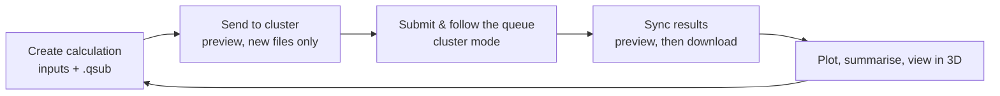

<div align="center">

# Lain: QE Studio

**Browse, sync and plot [Quantum ESPRESSO](https://www.quantum-espresso.org/) runs, and generate new calculations, from one desktop app.**

[](https://github.com/Mariano17omega/Lain/actions/workflows/ci.yml)
[](https://mariano17omega.github.io/Lain/)


[](https://docs.astral.sh/uv/)
[](https://github.com/astral-sh/ruff)


[Documentation (pt-BR)](https://mariano17omega.github.io/Lain/) · [Documentation (English)](https://mariano17omega.github.io/Lain/en/)


</div>

## What is Lain?

Lain is for people who run Quantum ESPRESSO on a cluster and are tired of juggling `scp`, ad-hoc plotting scripts and
hand-edited inputs. It keeps one local tree of your simulations, mirrors it with the cluster, recognises what each
folder holds, draws publication-ready figures and writes the next input and `.qsub` for you.



## Features

- **Detection by content**: bands, PDOS, relax / vc-relax and SCF runs are recognised from what the files contain,
  never from their names. A missing SCF is looked up in sibling `*scf*` folders; anything else can be mapped by hand.
- **Publication plots**: band structure, PDOS, bands + DOS, relax progress and SCF convergence; spin-polarized runs,
  gap readout in the legend, reusable plot styles, a tuning panel, PNG / SVG / PDF export and a CSV of the data.
- **Create calculation**: SCF, Relax, VC-Relax, Bands, PDOS, Charge, Charge difference, Slab, Supercell, Molecule on
  surface and Adsorption energy, each with the matching `.qsub`. Standard and Advanced modes, live 3D preview.
- **Cluster over ssh**: previewed pull and push with `rsync`; a cluster mode that lists, plots, submits, cancels and
  moves to a trash straight on the cluster; your queue on the top bar. Key or password login over one shared
  connection.
- **Viewers**: QE inputs with writing checks, side-by-side comparison and a chip strip of key parameters; one-click
  output summary (state, times, energies, gap, forces); a 3D structure viewer with distance and angle measures.
- **Comfortable to live in**: dark / light / system themes, font scale, command palette (`Ctrl+K`), favorites,
  history, Portuguese and English interface.

## Quick install

One script runs the steps below in order: it installs uv if needed, clones the repository, writes `config.yaml`
from your answers, offers the ssh key setup and installs the `lain` command. On Linux, run it in a terminal. On
Windows, run it in Git Bash, which comes with [Git for Windows](https://git-scm.com/download/win):

```bash
curl -fsSL https://raw.githubusercontent.com/Mariano17omega/Lain/main/install.sh | bash
```

It asks for `paths.local_root` (default `LUCCI` in your Documents folder, such as `~/Documentos/LUCCI`),
`paths.remote_root` (default `~/LUCCI`),
`paths.xcrysden_path` (filled in when `$XCRYSDEN_TOPDIR` or `xcrysden` on `PATH` finds it), `paths.data`, the cluster
login (`host`, `port` 22, `user`, `auth` key, `key_path`) and `jobs.myemail`; local paths are full paths (starting
with `/` or `~`). Steps that touch the cluster ask first.
Run `bash install.sh --config-only` in the repository to answer the questions again (the old `config.yaml` is kept
as `config.yaml.bak`).

## Install, step by step

**Requirements:** Linux (primary target), Python ≥ 3.11, [uv](https://docs.astral.sh/uv/), and `rsync` (≥ 3.1) plus
`ssh` if you will talk to a cluster.

**1. Install uv** (skip if you have it):

```bash
curl -LsSf https://astral.sh/uv/install.sh | sh
source ~/.bashrc
```

**2. Get the code:**

```bash
git clone git@github.com:Mariano17omega/Lain.git
cd Lain
```

**3. Create your configuration.** `config.yaml` is git-ignored because it may hold credentials:

```bash
cp config.example.yaml config.yaml
```

Open it and set at least where your simulations live:

```yaml
paths:
  local_root: ~/qe_simulations                      # your local tree
  remote_root: /home/your_user/qe_simulations       # the same tree on the cluster (optional)
cluster:
  host: cluster.example.org
  user: your_user
  auth: key
  key_path: ~/.ssh/id_ed25519
```

**4. (Cluster users) Set up an ssh key**, once:

```bash
ssh-keygen -t ed25519                                   # skip if ~/.ssh/id_ed25519 exists
ssh-copy-id -i ~/.ssh/id_ed25519.pub your_user@cluster.example.org
ssh your_user@cluster.example.org                       # must log in without a password; also trusts the host key
```

Lain refuses unknown host keys, so that last command is required. Passphrase keys must be loaded in `ssh-agent`;
password login is also supported. See the [SSH guide](https://mariano17omega.github.io/Lain/en/ssh/).

**5. Install the `lain` command** (editable, so code changes apply without reinstalling):

```bash
uv tool install --editable .
```

**6. Run it:**

```bash
lain                              # or: lain --config /path/to/config.yaml   (--verbose for a debug log)
```

From any folder `lain` reads the `config.yaml` at the root of this repository, unless the current folder has its own.

**7. (Optional) Add Lain to your application menu** with its icon:

```bash
uv run python scripts/install_desktop.py              # into ~/.local/share  (--prefix DIR for elsewhere)
```

Prefer not to install? `uv sync && uv run lain` runs it straight from the repository. A non-editable
`uv tool install .` also works; then keep the config in `~/.config/qe-studio/config.yaml` or pass `--config`.
More in the [installation guide](https://mariano17omega.github.io/Lain/en/installation/).

## First steps

1. Pick a simulation folder in the tree; the badges (`BANDS`, `PDOS`, `RELAX`, `SCF`) show what was detected.
2. Click **Plot** (or `Ctrl+G`), tune the figure and **Exportar** (`Ctrl+E`) into the folder's `plots/`.
3. Use **Criar cálculo** to write the next input and `.qsub`, **Enviar ao cluster** to upload them, then the cluster
   mode to submit and **Sincronizar** to bring results back.

A layout Lain likes (every first-level folder is a *project*):

```text
~/qe_simulations/
└── Pt111/
    ├── 0_SCF/   1_Relax/   2_Bands/
    └── 3_PDOS/orbitals/
```

| Shortcut | Action | Shortcut | Action |
|---|---|---|---|
| `Ctrl+K` | Command palette | `Ctrl+G` / `Ctrl+E` | Generate / export plot |
| `F1` | All shortcuts | `Ctrl+T` | Toggle theme |
| `Alt+←` / `Alt+→` | Folder history | `F5` | Refresh |

## Documentation

| | |
|---|---|
| [Quick start](https://mariano17omega.github.io/Lain/en/quickstart/) | first run and shortcuts |
| [Configuration](https://mariano17omega.github.io/Lain/en/config/) | every `config.yaml` key |
| [Folder organization](https://mariano17omega.github.io/Lain/en/folders/) | how to lay out local and cluster folders |
| [Workflow](https://mariano17omega.github.io/Lain/en/workflow/) | recommended order of calculations |
| [Features](https://mariano17omega.github.io/Lain/en/features/) | explorer, viewers, 3D, sync, log |
| [Plots](https://mariano17omega.github.io/Lain/en/plots/) | one page per plot type |
| [Create calculation](https://mariano17omega.github.io/Lain/en/create-calc/) | one page per calculation type |
| [SSH connection](https://mariano17omega.github.io/Lain/en/ssh/) | key and password login |
| [Remote mode](https://mariano17omega.github.io/Lain/en/remote-mode/) | exactly what Lain runs on the cluster |
| [Architecture](https://mariano17omega.github.io/Lain/en/architecture/) | diagrams and UML |
| [Code map](https://mariano17omega.github.io/Lain/en/code-map/) | where to review or change each part |
| [Troubleshooting](https://mariano17omega.github.io/Lain/en/troubleshooting/) | common problems |

The sources are in [`docs/`](docs/). To read them locally: `uv sync --group docs && uv run mkdocs serve`.

## Safety

- Unknown ssh host keys are always refused; passwords reach ssh only through `SSH_ASKPASS`, never a command line or
  the log.
- Pull and push always show a preview first; push only adds files and never overwrites or deletes on the cluster.
- Lain never deletes on the cluster: "Apagar…" moves items into a `trash/` folder. Cluster commands run only after you
  confirm them, and only for jobs it can identify as yours.
- Your files are never overwritten without asking; data files are written atomically.

## Built with

PyQt6 · matplotlib · NumPy / SciPy · ASE · spglib · Jinja2 · pydantic · PyYAML, managed with uv. Fonts (Inter,
JetBrains Mono: OFL) and Material Symbols icons (Apache-2.0) are vendored under `src/qe_studio/ui/resources/`.

## Development

```bash
uv sync
uv run pytest -m "not realdata and not perf"    # what CI runs
uv run ruff check . && uv run ruff format --check . && uv run pyright
uv run python scripts/i18n.py check             # the English catalog is complete
uv run python scripts/screenshot.py --plot      # off-screen PNGs of both themes into screenshots/
```

The tests never reach a real cluster: sync tests drive `rsync` and `ssh` against a local paramiko server. Rules for
contributors (architecture, threading, i18n, logging) are in [`CLAUDE.md`](CLAUDE.md) and the
[development guide](https://mariano17omega.github.io/Lain/en/development/). Translations:
[`src/qe_studio/locale/README.md`](src/qe_studio/locale/README.md).

## Limitations

- Spin: collinear runs (`nspin = 2`) only; non-collinear and spin-orbit runs keep a single channel. k-resolved PDOS
  files are reported as unsupported.
- Linux is the primary target. On Windows, `rsync` and `ssh` must come from cwRsync or MSYS2
  (`sync.rsync_binary`, `sync.ssh_binary`).
