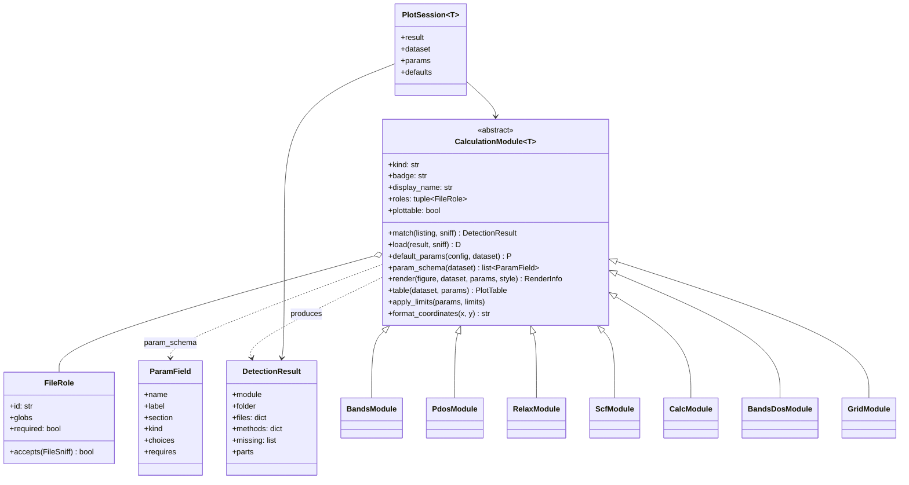
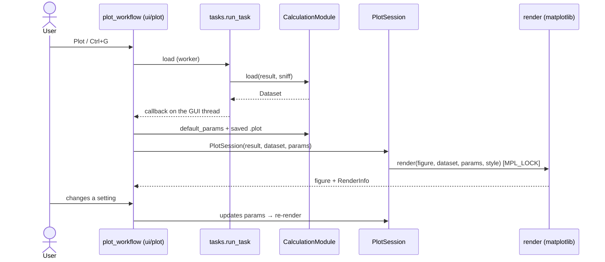

# Calculation modules (plots)

Each plot type is a subclass of `CalculationModule[Dataset, Params]` registered in
`core/calculations/__init__.py:REGISTRY`. The tuning panel is **generated** from the `ParamField` list.

## Sequence: from click to drawing

## A module's package

A typical module (`core/calculations/bands/`): `detection.py` (roles), `data.py` (dataset), `params.py` (`Params` +
`ParamField`), `render.py`, `table.py` (CSV) and `module.py` (ties it together). The **style** comes from
`core/plotting/style.py:figure_style(params.background)`, never from the app theme. A color declares
`metadata={"kind": "color"}` so a style can set it.

Test contract: `tests/test_module_contract.py` (`DummyModule`) — extend it when the contract grows.
