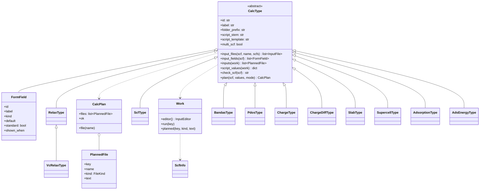
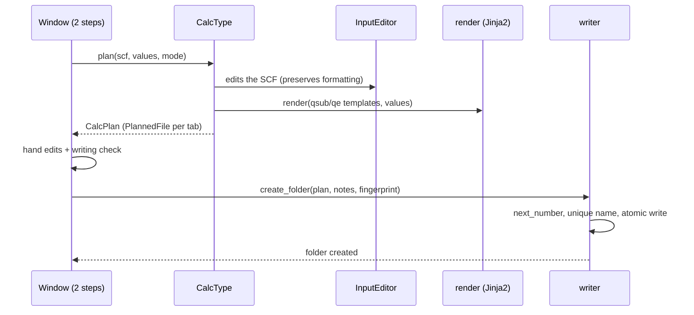

# Create calculation (UML and pipeline)

## Pipeline

- `plan()` **never raises nor reads a file**; problems come back in `CalcPlan`/`field_problems`.
- The window knows no type: it lists `REGISTRY`, draws the `FormField`s that `shown_fields` keeps for the mode and
  shows the `PlannedFile`s in tabs.
- **Modes**: `padrao` shows `standard` fields; the others take their default. `avancado` shows all and the file names.
  `shown_when` hides fields that depend on others.
- Templates in `src/qe_studio/resources/templates/{qsub,qe}/`; `qsub/_base.qsub.j2` is the common base (SGE header,
  Intel MPI, e-mails) and each type extends it with `programs`, `body` and `post`.

Code: `core/calc_create/` — `types/` (one module per type + `base.py` + `__init__.py:REGISTRY`), `scf_info.py`,
`render.py`, `writer.py`, `numbering.py`, `fingerprint.py`, `surface/`.
