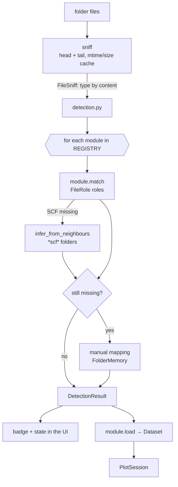

# Detection

- `core/sniff.py` classifies each file (`pw.x` input/output, `bands.x`, `projwfc.x`, `.gnu`, job log…). The cache is
  keyed by `(path, mtime, size)` and thread-safe; `sniff_once` memoizes within one detection.
- A `CalculationModule` declares `roles: tuple[FileRole]` — each role has an `accepts(FileSniff)` and `globs`.
- `Method` says how a role was filled: automatic, neighbour or manual.
- **Never-detected** modules (`BandsDosModule`, `GridModule`) are born from other results (`pair_result`,
  `grid_result`).
- `load` uses the `sniff` it receives (the caller's cache); never import the module-level `sniff`.

Code: `core/sniff.py`, `core/detection.py`, `core/calculations/base.py`, `core/calculations/__init__.py` (`REGISTRY`),
`core/project/folder_memory.py`.
