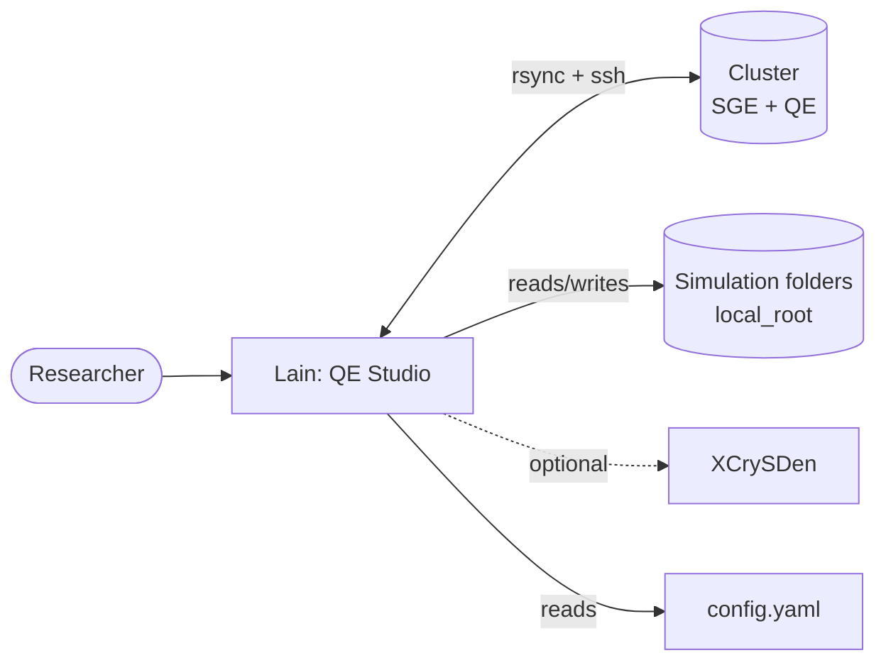
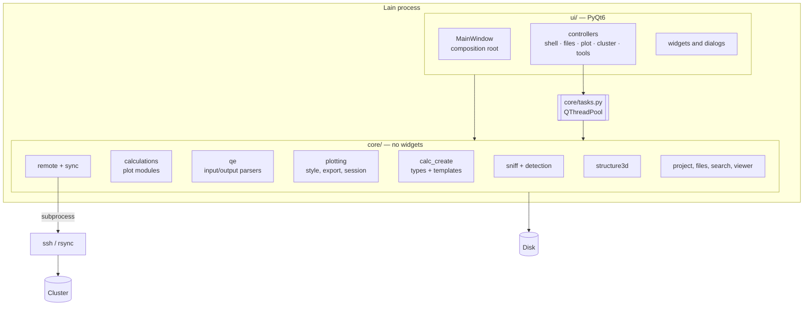

# Architecture — overview

Lain separates **logic** from **interface**:

- `src/qe_studio/core/` — logic without widgets, testable without Qt (parsers, detection, physics, files, sync,
  generation).
- `src/qe_studio/ui/` — the PyQt6 app: widgets, layout, dialogs and signal wiring.
- Package `qe_studio` (historical internal name) with the `lain` command.

## Context (level 1)

## Containers (level 2)

## Principles

1. **The GUI thread never reads or parses files**; everything goes through `core/tasks.py` (`run_task`, `TaskGroup`).
2. **Identification by content**, never by file name.
3. **Modular**: a new plot or calculation type is a new module plus a registration (`REGISTRY`), not an `if` in a
   central class. The UI does not know `kind == "bands"`.
4. **Cluster safety**: strict ssh, commands only from programs in the config, a preview before transfers, nothing
   deleted.
5. **Data integrity**: never overwrite a user file without asking; atomic writes.

## Pages

| Page | Content |
|---|---|
| [Layers and rules](layers.md) | areas of `core/` and `ui/`, rules checked by a test |
| [Detection](detection.md) | `sniff` → `FileRole` → modules |
| [Calculation modules](calc-modules.md) | UML of the plot modules |
| [Create calculation](create-calc.md) | UML of the types and the generation pipeline |
| [Threading](threading.md) | tasks, cancellation, matplotlib |
| [Sync and cluster](sync-cluster.md) | components of the remote backend |
| [State and persistence](state.md) | where each piece of data lives |
| [UI composition](ui-composition.md) | `MainWindow`, controllers, actions, shutdown |
