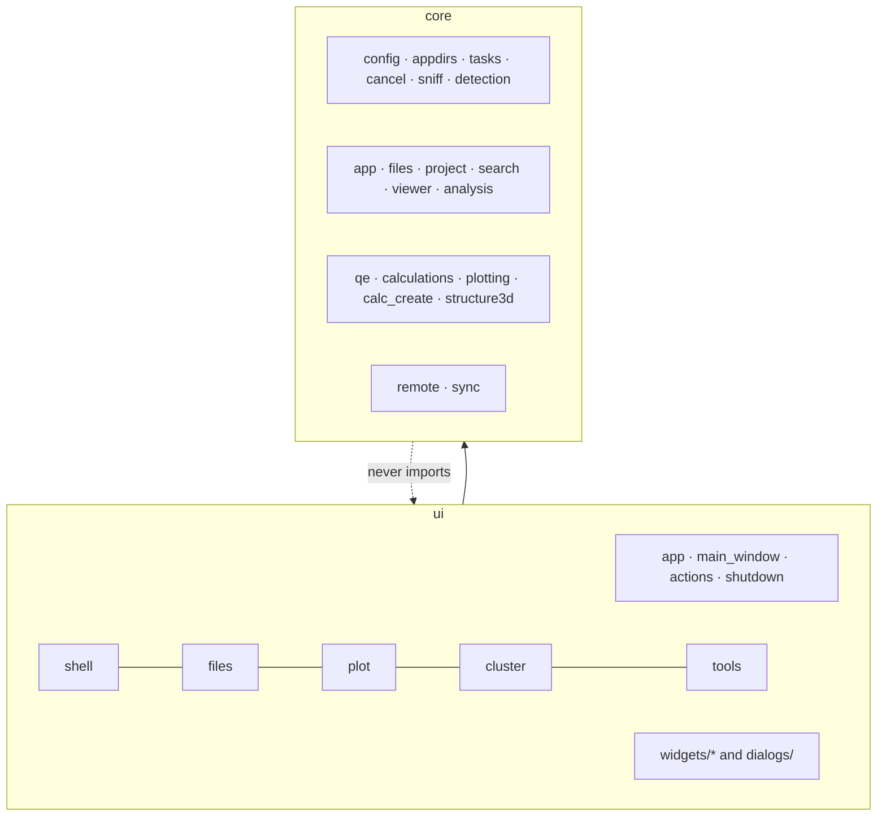

# Layers and rules

## Areas of `core/`

| Area | Holds |
|---|---|
| (top) | `config`, `config_template`, `appdirs`, `tasks`, `cancel`, `sniff`, `detection` |
| `app` | language at start, "About", colors, font scale, log |
| `files` | file kinds, folder rules, operations, external programs |
| `project` | what `.lain/` keeps (projects, grids, compounds, favorites) |
| `search` | command palette (folder index, fuzzy search) |
| `viewer` | text viewer |
| `analysis` | sums over results (adsorption energy) |
| `qe` | QE input/output parsers and editing |
| `calculations` | plot modules |
| `plotting` | style, export, session, grids |
| `calc_create` | "Criar cálculo" types and templates |
| `structure3d` | 3D model, bonds, camera, measures |
| `remote`, `sync` | cluster |

## Areas of `ui/`

At the top only `app`, `main_window`, `actions`, `shutdown`. A controller goes in `ui/<area>/` and its widgets in
`ui/widgets/<area>/`: `shell` (window, language, layout, help, palette), `files`, `plot`, `cluster`, `tools`. Dialogs in
`ui/dialogs/`; the text viewer in `ui/widgets/viewer/`.

## Rules checked by `tests/test_architecture.py`

- No file over **500 lines** (`main_window.py` 450).
- `core/` never imports `qe_studio.ui`. PyQt6 in `core/` only in `sync/_process.py`, `sync/controller.py`,
  `sync/monitor.py` and `tasks.py`.
- `ui/` holds interface logic only: no file reads (`open(`, `read_text`, `loadtxt`…); disk calls (`exists`, `stat`,
  `iterdir`…) are counted per file and may only go down.
- Modules at the top of `core/`, `ui/` and `ui/widgets/` only those listed in `TOP_LEVEL`.
