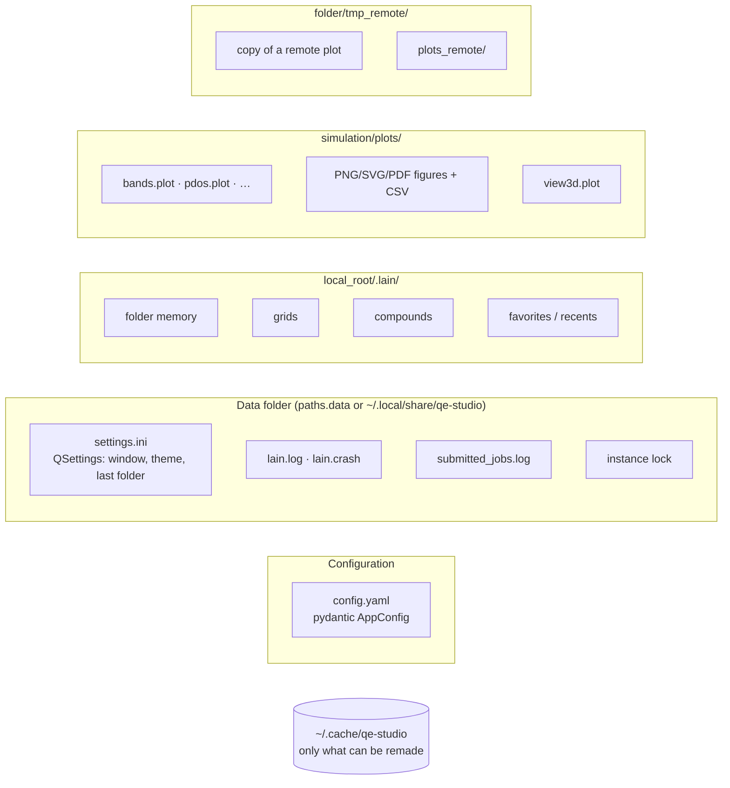

# State and persistence

| Data | Where | Written by |
|---|---|---|
| Config | `config.yaml` | the user (read-only for Lain) |
| UI state | QSettings (`<data>/settings.ini`) | `ui/*` |
| Per-root data | `<local_root>/.lain/` (only `core/project/project_data.py` names the folder) | `core/project/*` |
| Settings and exports | `<simulation>/plots/` | `core/plotting/*` |
| Remote plot copy | `<folder>/tmp_remote/` | `core/remote/scratch.py` (overwrites without asking, only here) |
| Submitted jobs | `<data>/submitted_jobs.log` | `core/remote/submit_log.py` |
| Log | `<data>/lain.log` | `core/app/logs.py` |
| Plot styles | `resources/templates/plot_styles/*.yaml` | read-only |

- **Integrity**: never overwrite a user file without asking (`core/files/unique_names.py`: `_2` suffixes); data files
  are written whole with `core/appdirs.py:atomic_write_text`.
- Nothing else is written into simulation folders.
- Language influences nothing that persists (`.lain/`, `.plot`, exports, QSettings) — verified by a test.
