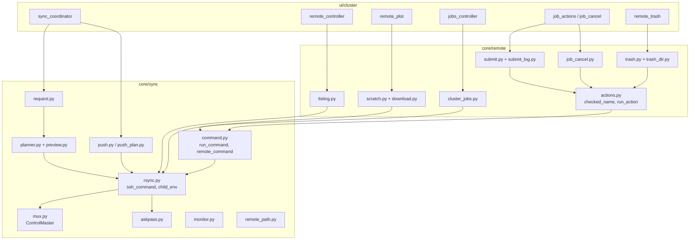
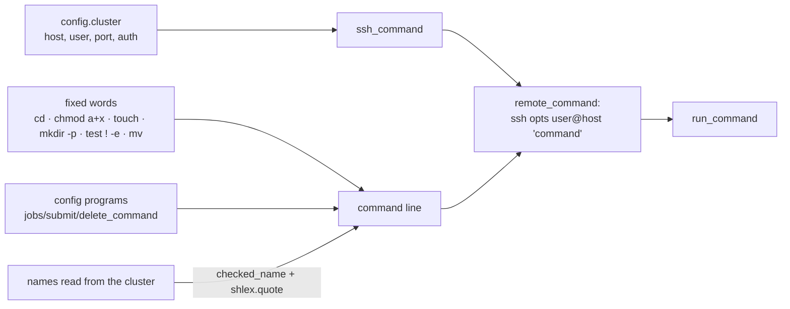

# Sync and cluster (components)

## Roles

| Module | Responsibility |
|---|---|
| `core/sync/rsync.py` | the **only** place that builds ssh options (`ssh_command`) and the child's environment (`child_env`); rsync arguments |
| `core/sync/command.py` | runs a remote command (`remote_command`), with timeout and cancellation, no stdin or terminal |
| `core/sync/mux.py` | shared connection (`ControlMaster=auto`, `ControlPersist=120`, short `0700` `ControlPath`) |
| `core/sync/askpass.py` | `SSH_ASKPASS` helper (`qe-studio-askpass`) |
| `core/sync/planner.py`, `preview.py` | rsync *dry run* → plan → preview |
| `core/sync/push.py`, `push_plan.py` | upload of new files only |
| `core/sync/monitor.py` | reachability probe (LED) |
| `core/remote/actions.py` | validation (`checked_name`, `checked_dir`), execution, failure classification |
| `core/remote/listing.py` | `rsync --list-only` |
| `core/remote/submit.py`, `job_cancel.py`, `trash.py` | the three commands that change the cluster |
| `core/remote/scratch.py`, `download.py` | copy into `tmp_remote/` |

## Failure classification

`classify_failure` tells apart: timeout (`connection`), refused authentication (`auth`), command not found
(`missing`, code 127), unreachable cluster (`connection`) and the command's own error — each with its own message and,
when relevant, the hint to use the program's full path.

## How a remote command is composed

