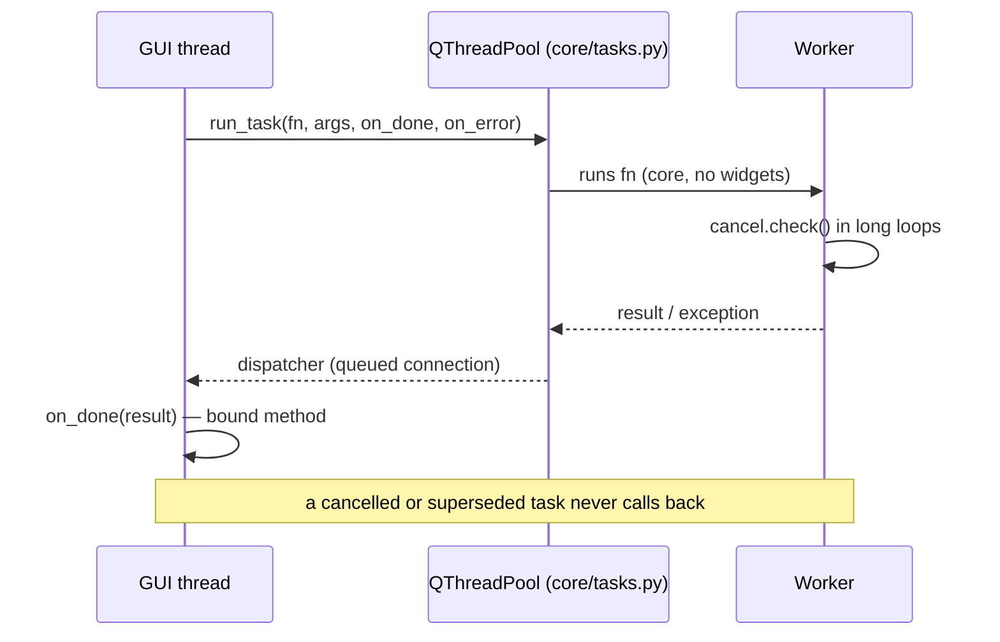

# Threading

- **The GUI never reads or parses files.** Every background task goes through `core/tasks.py` (`run_task`,
  `TaskGroup`). `TaskGroup` keys tasks: a new one for the same key supersedes the previous, whose result is dropped.
- **Cooperative cancellation**: a long loop in `core/` calls `core/cancel.py:check()`; `run_command` kills the child
  process (ssh/rsync) and raises `Cancelled`.
- **Callbacks** are bound methods; if the receiver is a `QObject`, only a weak reference is kept and its destruction
  cancels the task.
- **Private pools** have no Qt parent (avoids a deadlock in the C++ destructor holding the GIL). Owners call
  `TaskGroup.shutdown` when closing.
- **matplotlib** has global state: `core/plotting/mpl_lock.py:MPL_LOCK` serializes it; the GUI only *tries* the lock.
- Exception: `core/sync/monitor.py` probes in *daemon* threads (a DNS lookup can block past the timeout).
- Closing: `ui/shutdown.py` — a new job joins the shutdown steps, takes the time it is given and reports whether it
  finished.
