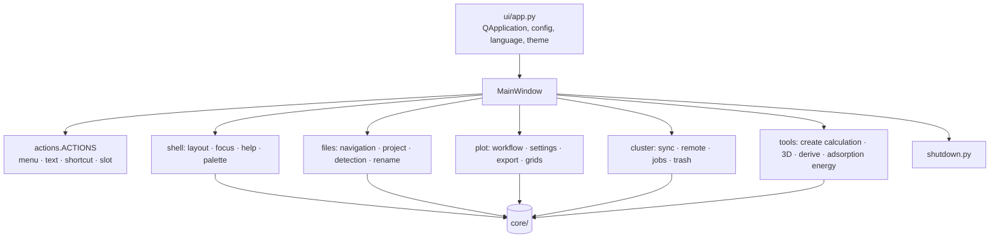

# UI composition

`ui/main_window.py:MainWindow` is the **composition root**: it builds widgets, controllers and stores, keeps only what
spans controllers, and a thin facade used by tests and by `scripts/screenshot.py`.

- **A new feature** gets its own controller, built by a `for_window(window)` factory.
- **Window actions**: `ui/actions.py:ACTIONS` (stable id, menu, text, shortcut, slot path). Keys a widget handles itself
  go in `shortcut_help()`.
- **Closing**: `ui/shutdown.py`. A non-modal dialog's controller implements `close_dialog() -> bool`.
- **Dialogs** use `WA_DeleteOnClose`, except a modal `exec()` whose answer is read afterwards.
- **Long-lived signals** connect to bound methods, not lambdas.
- **Theme**: modular QSS in `ui/resources/styles/<domain>/*.qss` with `${token}` from
  `ui/resources/themes/{dark,light}.yaml`.
- **Sizes** that hold text come from the font scale (`core/app/fontscale.py`, `ui/theme/scale.py`).
- **Language**: texts in Portuguese inside `_()`; English comes from `locale/en/LC_MESSAGES/lain_<domain>.po`.
