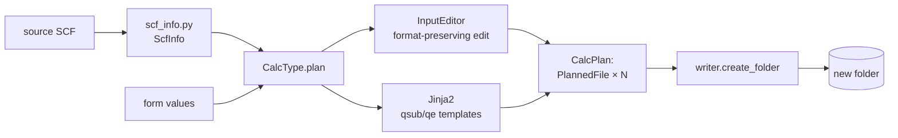

# Create calculation — overview

**Criar cálculo…** (sidebar or *Tools* menu) generates a **new folder** with the QE inputs and the cluster `.qsub`
script, from an **SCF you already have**. Nothing is executed: you review, edit, send and submit.

## Types

| Type | Generates | Page |
|---|---|---|
| SCF | `scf_<prefix>.in` + `scf.qsub` | [SCF](scf.md) |
| Relaxation | `relax_<prefix>.in` or `vc-relax_<prefix>.in` + `relax.qsub` | [Relaxation](relax.md) |
| Bands | SCF, `bands.in`, `bands_pp*.in`, `bands.qsub` | [Bands](bands.md) |
| PDOS | SCF, NSCF, `projwfc.in`, `pdos.qsub` | [PDOS](pdos.md) |
| Charge | SCF + `pp_<name>_charge.in` | [Charge](charge.md) |
| Charge difference | 3 SCFs + 4 `pp.x` | [Charge difference](charge-diff.md) |
| Slab | slab `relax_*.in` (or `vc-relax_*.in`) + `geracao.md` | [Slab](slab.md) |
| Supercell | repeated `relax_*.in` (bulk: `vc-relax_*.in`) + `geracao.md` | [Supercell](supercell.md) |
| Molecule on surface | complex `relax_*.in` + `geracao.md` | [Adsorption](adsorption.md) |
| Adsorption energy | copies of N SCFs + `ads_energy.qsub` | [Adsorption energy](adsorption-energy.md) |

## Two steps

1. **Step 1 — source and type**: pick the type, the source SCF(s), the location and the folder name/suffix. Lain
   extracts the structure, cutoffs, k-mesh etc. from the SCF (`core/calc_create/scf_info.py`) and can show a 3D preview.
2. **Step 2 — review**: the type's form and **one tab per file** to generate (script, inputs, `Descrição` in
   Markdown). The preview updates as you edit; the input's problems show as in the viewer.

## Modes

- **Padrão** (standard): only the essential fields; the rest takes the validated default.
- **Avançado** (advanced): all fields and each file's name. Inputs and scripts can be hand-edited.

## Rules

- The folder is new: `<number>_<Type>[_suffix]` (see [numbering](../folders.md#folder-numbering-in-criar-calculo)); an
  existing folder is never overwritten.
- `jobs.cores` (NP), `jobs.pseudo_dir` and `jobs.myemail` from `config.yaml` set the script defaults.
  An input with `K_POINTS gamma` (or no card) and `nk` above 1 gets a warning: `pw.x` stops with pools in that case.
- **Pools (`nk`)**: the field (Avançado mode) opens filled with the value Lain computes, and you can change it;
  emptied, it goes back to the computed one. The value follows NP and the irreducible k-points of the `pw.x` inputs
  (from the symmetry of the structure in the input; with `nspin = 2` both spins count; the input with the fewest
  k-points decides): `nk` is a multiple of 4, at most 16, divides NP and leaves at least 4 cores per pool, and the
  largest one with no pool more than 20 % idle wins. A single k-point (`gamma`) takes 1. With NP = 64 or 128: 10
  k-points give `nk = 4`, 36 give 8, 47 give 16. An `nk` with more pools than k-points, or not a multiple of 4 up to
  16, gets a warning.
- **Gerar fingerprint.md** (off by default, remembered): records type, final name, time, Lain version and source SCFs.
- Every script follows the cluster's current model (SGE + Intel MPI), in `resources/templates/qsub/`.
- **Every step is checked** (`check_step`, one line after each program): the status, `JOB DONE`
  at the end of the output and the messages `pw.x` prints when it stops before finishing (SCF not converged, `.EXIT`,
  `max_seconds`, a relax that reaches `nstep` or whose BFGS failed; `pw.x` leaves with status 0 and `JOB DONE` in these
  cases too). At the first step that fails, the job ends without running the next ones, the e-mail arrives as
  `Job failed: <output>` and the `.o` log gets the line `Job failed: …`, so Lain marks it as an error.

## What is behind it

Details and UML in [Architecture ▸ Create calculation](../architecture/create-calc.md).
