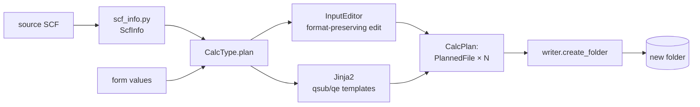

# Create calculation — overview

**Criar cálculo…** (sidebar or *Tools* menu) generates a **new folder** with the QE inputs and the cluster `.qsub`
script, from an **SCF you already have**. Nothing is executed: you review, edit, send and submit.

## Types

| Type | Generates | Page |
|---|---|---|
| SCF | `scf_<prefix>.in` + `scf.qsub` | [SCF](scf.md) |
| Relax | `relax_<prefix>.in` + `relax.qsub` | [Relax](relax.md) |
| VC-Relax | `vc-relax_<prefix>.in` + `vc-relax.qsub` | [VC-Relax](vc-relax.md) |
| Bands | SCF, `bands.in`, `bands_pp*.in`, `bands.qsub` | [Bands](bands.md) |
| PDOS | SCF, NSCF, `projwfc.in`, `pdos.qsub` | [PDOS](pdos.md) |
| Charge | SCF + `pp_<name>_charge.in` | [Charge](charge.md) |
| Charge difference | 3 SCFs + 4 `pp.x` | [Charge difference](charge-diff.md) |
| Slab | slab `vc-relax_*.in` + `geracao.md` | [Slab](slab.md) |
| Supercell | repeated `vc-relax_*.in` + `geracao.md` | [Supercell](supercell.md) |
| Molecule on surface | complex `relax_*.in` + `geracao.md` | [Adsorption](adsorption.md) |
| Adsorption energy | copies of N SCFs + `ads_energy.qsub` | [Adsorption energy](adsorption-energy.md) |

## Two steps

1. **Step 1 — source and type**: pick the type, the source SCF(s), the location and the folder name/suffix. Lain
   extracts the structure, cutoffs, k-mesh etc. from the SCF (`core/calc_create/scf_info.py`) and can show a 3D preview.
2. **Step 2 — review**: the type's form and **one tab per file** to generate (script, inputs, `Descrição` in
   Markdown). The preview updates as you edit; writing errors show as in the viewer.

## Modes

- **Padrão** (standard): only the essential fields; the rest takes the validated default.
- **Avançado** (advanced): all fields and each file's name. Inputs and scripts can be hand-edited.

## Rules

- The folder is new: `<number>_<Type>[_suffix]` (see [numbering](../folders.md#folder-numbering-in-criar-calculo)); an
  existing folder is never overwritten.
- `jobs.cores` (NP), `jobs.nk`, `jobs.pseudo_dir` and `jobs.myemail` from `config.yaml` set the script defaults.
- **Gerar fingerprint.md** (off by default, remembered): records type, final name, time, Lain version and source SCFs.
- Every script follows the cluster's current model (SGE + Intel MPI), in `resources/templates/qsub/`.

## What is behind it

Details and UML in [Architecture ▸ Create calculation](../architecture/create-calc.md).
