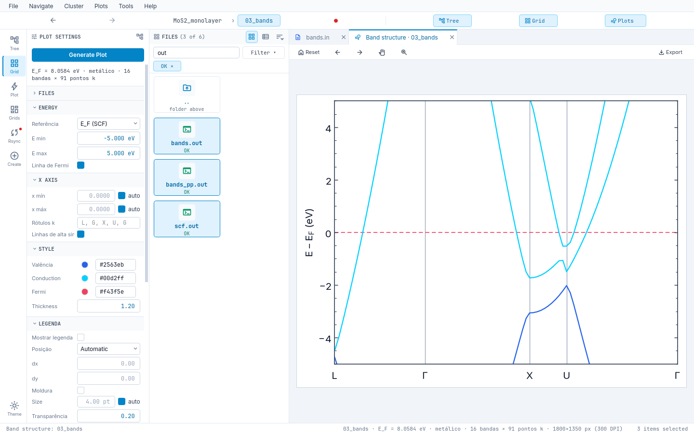

# Appearance and language

- **Theme**: `dark`, `light` or `system` (`ui.theme`); `Ctrl+T` cycles and remembers. Modular QSS with color *tokens*
  in `ui/resources/themes/{dark,light}.yaml`, all checked for WCAG AA contrast.
- **Font**: `ui.font_scale` from 0.8 to 1.6 (everything that holds text scales). Inter and JetBrains Mono bundled.
- **Accessibility**: visible focus, `Tab` order and `Ctrl+1..4`.
- **Language**: `ui.language` = `auto` | `pt_BR` | `en` (applies at start). `auto` uses Portuguese for `pt*` and
  English otherwise. The `QE_STUDIO_LANGUAGE` / `LAIN_LANGUAGE` variables take precedence.
- **Figures** do not follow the app theme: the background comes from the parameters/style (white by default), so the
  preview and the export match.

