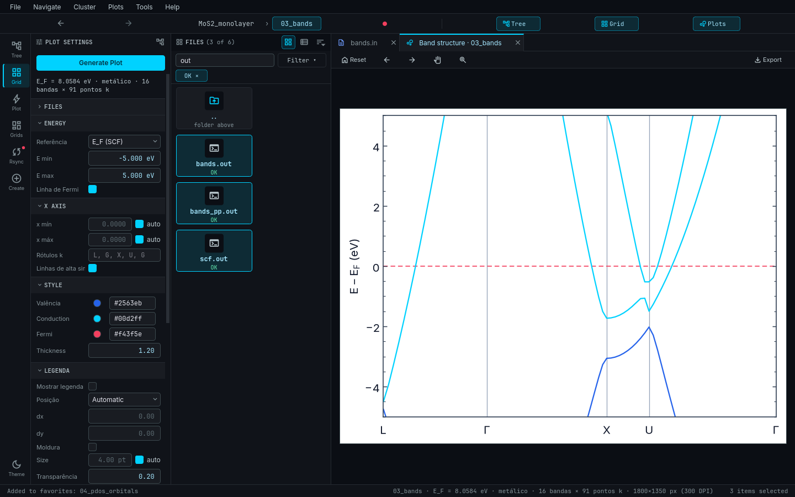

# Lain: QE Studio

**Lain: QE Studio** is a desktop application (PyQt6) to **browse, sync and plot**
[Quantum ESPRESSO](https://www.quantum-espresso.org/) simulations (QE **7.1 or newer**), and to **generate new
calculations** (`pw.x`, `bands.x`, `projwfc.x`, `pp.x` inputs and `.qsub` scripts) from an SCF you already have.

## What it does

- **Detects** the type of each folder (SCF, relax, bands, PDOS…) from the **content** of its files, never from names.
- **Plots** bands, PDOS, bands + DOS, relax/vc-relax and SCF convergence, with a tuning panel and PNG/SVG/PDF
  (+ CSV) export.
- **Creates calculations** ("Criar cálculo" / *Create calculation*): SCF, Relax, VC-Relax, Bands, PDOS, Charge,
  Charge difference, Slab, Supercell, Molecule on surface and Adsorption energy.
- **Syncs** with the cluster through `rsync` + `ssh` (always with a preview) and has a **cluster mode** that lists,
  plots, submits, cancels and moves to trash straight on the cluster.
- Shows the **structure in 3D**, with distance and angle measurements.

## Documentation map

| I want to… | Go to |
|---|---|
| Install and start | [Installation](installation.md), [Quick start](quickstart.md) |
| Configure `config.yaml` | [Configuration](config.md) |
| Organize my folders | [Folder organization](folders.md), [Workflow](workflow.md) |
| Understand each feature | [Features](features/index.md) |
| Plot | [Plots](plots/index.md) |
| Generate inputs and `.qsub` | [Create calculation](create-calc/index.md) |
| Connect to the cluster | [SSH connection](ssh.md), [Remote mode](remote-mode.md) |
| Understand or change the code | [Architecture](architecture/index.md), [Code map](code-map.md) |
| Fix a problem | [Troubleshooting](troubleshooting.md), [Glossary](glossary.md) |

!!! note "Language"
    Lain's interface comes in Portuguese and English (`ui.language`). Menu and button names are quoted as they
    appear in Portuguese, with the English equivalent in the [glossary](glossary.md).
