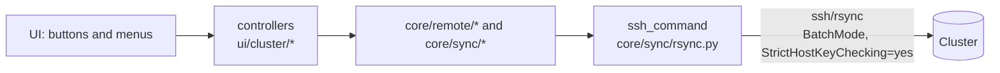
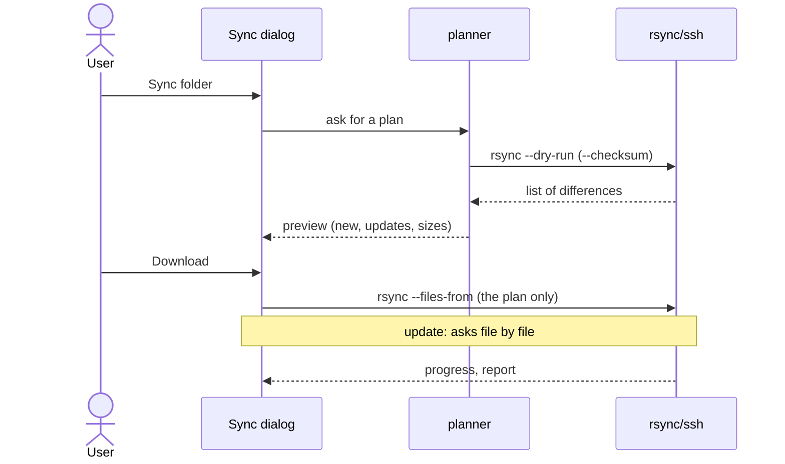
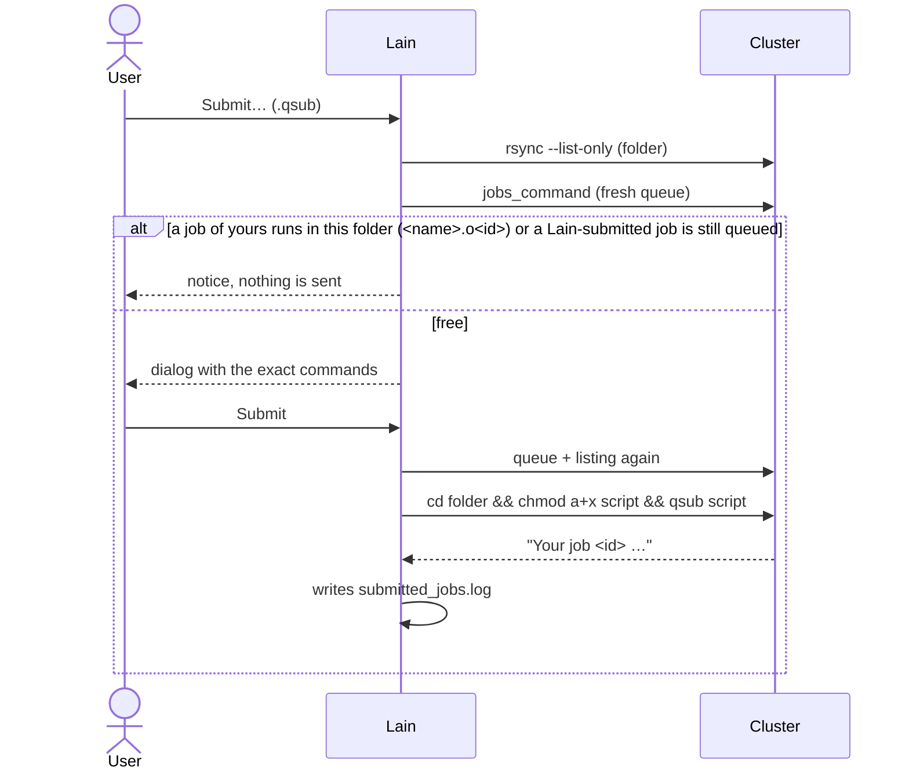
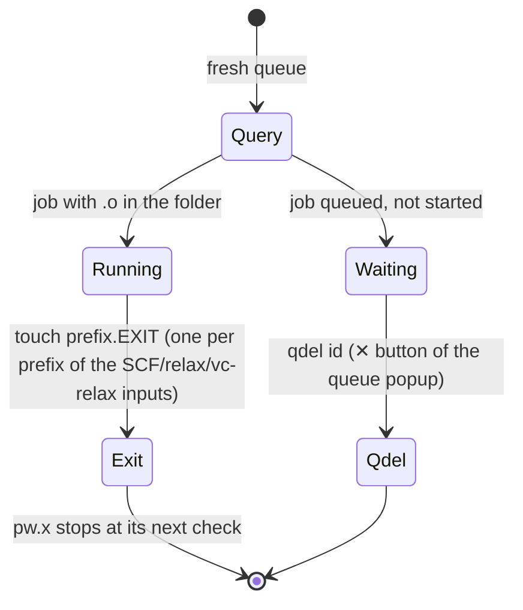

# Remote mode and cluster commands

Lain never runs its own code on the cluster: it builds **fixed command lines** and runs them over `ssh`/`rsync`, with
the same options and login. This page shows exactly what is executed.

## Overview

Every call goes through `core/sync/rsync.py:ssh_command` (ssh options) and runs in a **background thread**
(`core/tasks.py`). Commands that **change** the cluster run only after a confirmation dialog showing the exact
command.

## Command catalog

| Action | What runs | Code |
|---|---|---|
| Test connection | TCP probe (no login) | `core/sync/monitor.py` |
| List folder (cluster mode) | `rsync --list-only` | `core/remote/listing.py` |
| Job queue | `cluster.jobs_command` (e.g. `qstatus -a`) | `core/remote/cluster_jobs.py` |
| Download (pull) | `rsync` with **dry run** + preview + copy | `core/sync/planner.py`, `rsync.py` |
| Upload (push) | `rsync --ignore-existing` (new files only) | `core/sync/push*.py` |
| Remote plot | `rsync` of the folder into `tmp_remote/` | `core/remote/scratch.py`, `download.py` |
| Submit `.qsub` | `cd <folder> && chmod a+x <script> && qsub <script>` | `core/remote/submit.py` |
| Cancel running job | `touch <folder>/<prefix>.EXIT` (one per prefix) | `core/remote/job_cancel.py` |
| Cancel waiting job | `qdel <job-id>` | `core/remote/job_cancel.py` |
| Delete (move) | `cd <root> && mkdir -p … && test ! -e <target> && mv <item> <target>` | `core/remote/trash.py` |

The only programs that are not fixed words come from `config.yaml`: `jobs_command`, `submit_command`,
`delete_command`. Names read from the cluster (file, folder, prefix, job-id) enter **only as arguments**, after
`checked_name` (letters, digits, `.`, `_`, `+`, `-`) and `shlex.quote`.

## Synchronization (pull)

- Rule: file only on the cluster → downloaded; cluster copy newer or different content → you choose (overwrite this /
  all in the folder / keep local / cancel); local newer → kept.
- rsync runs with `LC_ALL=C.UTF-8`, `TZ=UTC` and `--no-h` (its output is parsed) and `--exclude` from `sync.exclude`.
- `.lain/`, `tmp_remote/` and (at the root) `trash/` are fixed exclusions.

## Upload (push)

Always with a preview. It only adds files the cluster does **not** have (`--ignore-existing`); it never overwrites or
deletes, never sends into `trash/`, and `push_exclude` (`plots/`, `*.plot`) stays out.

## Cluster mode

The **Cluster** button swaps the tree and grid for the remote files (red background). Listings are kept in memory
per session and refreshed in the background after 60 s. Context menu:

- **Baixar** (download) — the usual pull, with preview.
- **Plotar** (plot) — copies the folder (less `sync.exclude`) into the local `tmp_remote/` and plots from there; each
  new plot overwrites the copy **without asking** (only there). The preview shows only for a file over 100 MB.
- **Submeter…** (submit) — see below.
- **Cancelar simulação…** (cancel) — see below.
- **Apagar…** (delete) — moves to the trash, does not delete.

### Submit

If a job of yours with the same `#$ -N` is already running or waiting anywhere, a dialog asks first ("Voltar" /
*Back* is the default). `submitted_jobs.log` (in the data folder) remembers Lain-submitted jobs still in the queue.

### Cancel

Never by guessing: a **fresh queue** right before acting decides.

A **running** job is stopped only by creating `<prefix>.EXIT` (the cluster administrator's rule); `qdel` applies only
to a **waiting** job, by ID. The script's next commands still run (nscf, bands.x, projwfc.x…).

### Delete (trash)

`<root>/project/PDOS` becomes `trash/project/PDOS_2026-10-30_14-02-11/`. Blocked when a job of yours runs in the
folder (or below), or a Lain-submitted job is still queued; no sync starts until the `mv` ends. Lain **never** really
deletes: empty `trash/` from a terminal on the cluster.

## Security summary

- An unknown host key is always refused (`StrictHostKeyChecking=yes` forced).
- Password only via `SSH_ASKPASS`; never in argv or log.
- Push never overwrites; pull goes through a dry run and a preview.
- The cluster is production: **no test** in the project reaches it (tests use a local `paramiko` SSH server).
