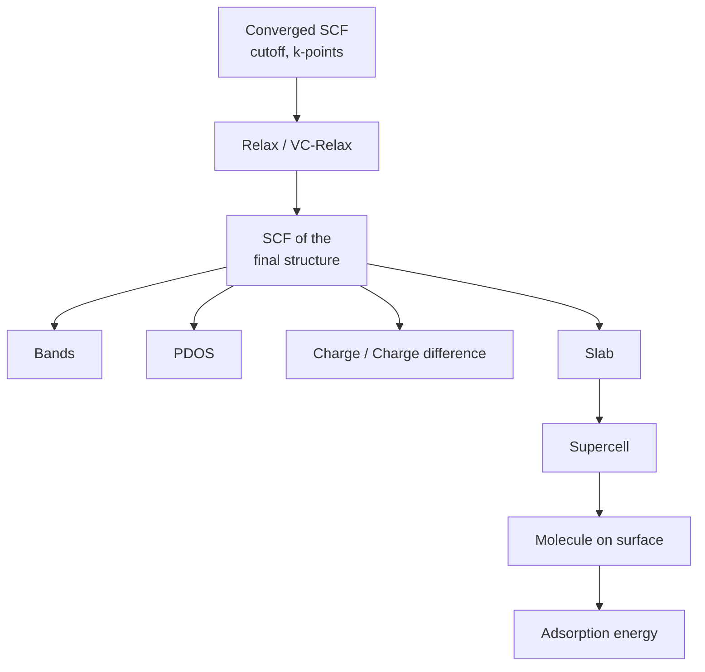
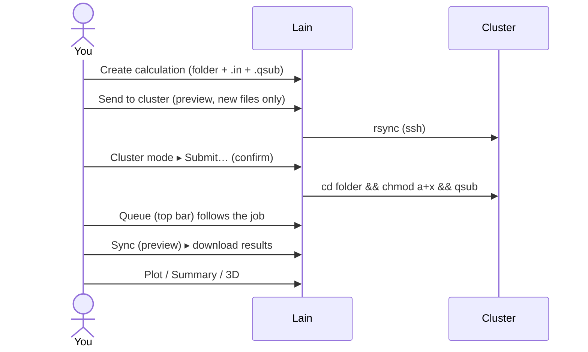

# Recommended workflow

## Suggested order

1. **SCF** with tested cutoffs and k-mesh. It is the base: almost every "Criar cálculo" type starts from an SCF.
2. **Relax** (positions) or **VC-Relax** (positions + cell). Follow `|ΔE|` and force in the [relax plot](plots/relax.md).
3. **Converged SCF**: from the context menu of a converged relax/vc-relax output, "Gerar SCF convergido" creates the
   `.in` with the final structure.
4. From the final SCF:
    - **Bands** (pw.x `bands` + `bands.x`) — [plot](plots/bands.md);
    - **PDOS** (NSCF + `projwfc.x`) — [plot](plots/pdos.md); join both in **Bands with DOS**;
    - **Charge** / **Charge difference** (`pp.x`) to view in XCrySDen.
5. **Surfaces**: Slab (opens vacuum) → Supercell (repeats the cell) → Molecule on surface → run the SCFs and compute
   the [adsorption energy](features/adsorption-energy.md).

## Daily loop

!!! tip "Never skip the SCF"
    Bands, PDOS and charge read the Fermi energy and the structure from the SCF. Keep it close: Lain looks for it in
    sibling `*scf*` folders.
