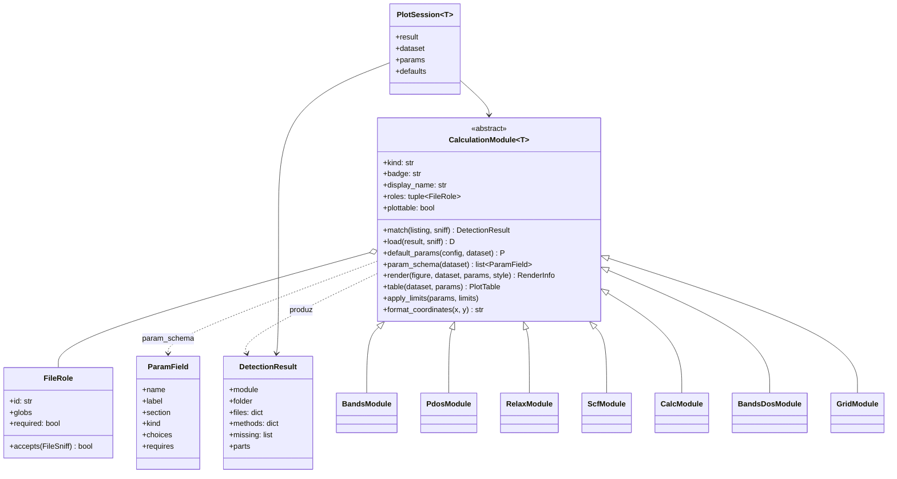
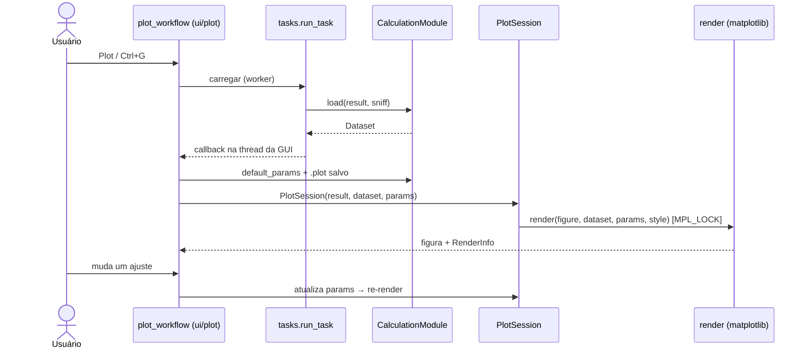

# Módulos de cálculo (gráficos)

Cada tipo de gráfico é uma subclasse de `CalculationModule[Dataset, Params]` registrada em
`core/calculations/__init__.py:REGISTRY`. O painel de ajustes é **gerado** da lista de `ParamField`.

## Sequência: do clique ao desenho

## Pacote de um módulo

Um módulo típico (`core/calculations/bands/`): `detection.py` (papéis), `data.py` (dataset), `params.py`
(`Params` + `ParamField`), `render.py`, `table.py` (CSV) e `module.py` (liga tudo). O **estilo** vem de
`core/plotting/style.py:figure_style(params.background)`, nunca do tema do app. Uma cor declara
`metadata={"kind": "color"}` para que um estilo possa defini-la.

Contrato de teste: `tests/test_module_contract.py` (`DummyModule`) — estenda-o quando o contrato crescer.
