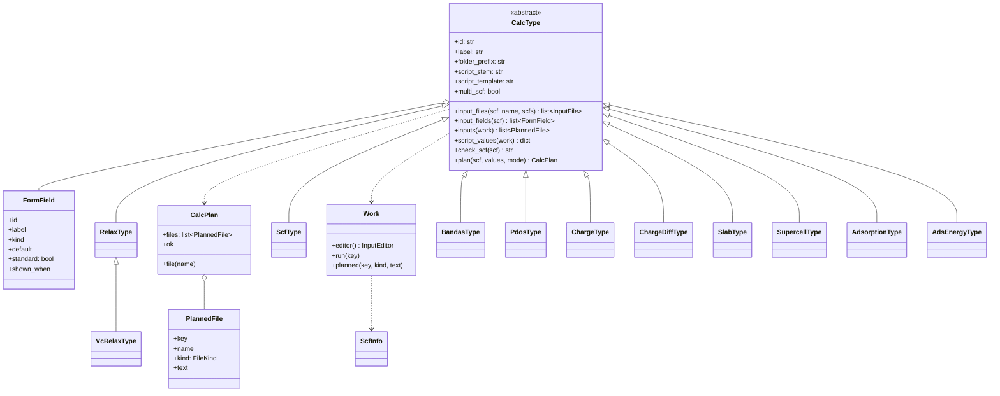
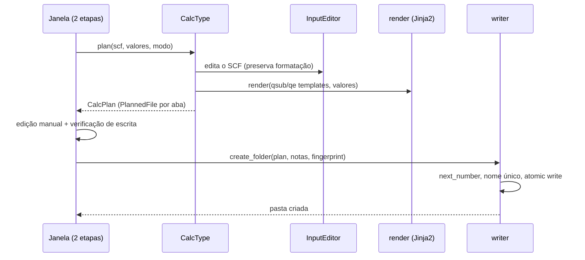

# Criar cálculo (UML e pipeline)

## Pipeline

- `plan()` **nunca levanta exceção nem lê arquivo**; os problemas voltam em `CalcPlan`/`field_problems`.
- A janela não conhece nenhum tipo: lista `REGISTRY`, desenha os `FormField` que `shown_fields` mantém para o modo e
  mostra os `PlannedFile` em abas.
- **Modos**: `padrao` mostra campos `standard`; os demais assumem o padrão. `avancado` mostra todos e os nomes dos
  arquivos. `shown_when` esconde campos que dependem de outros.
- Templates em `src/qe_studio/resources/templates/{qsub,qe}/`; `qsub/_base.qsub.j2` é a base comum (cabeçalho SGE, Intel
  MPI, e-mails) e cada tipo estende com `programs`, `body` e `post`.

Código: `core/calc_create/` — `types/` (um módulo por tipo + `base.py` + `__init__.py:REGISTRY`), `scf_info.py`,
`render.py`, `writer.py`, `numbering.py`, `fingerprint.py`, `surface/`.
