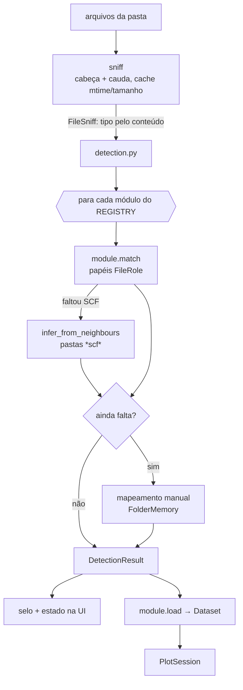

# Detecção

- `core/sniff.py` classifica cada arquivo (`pw.x` input/output, `bands.x`, `projwfc.x`, `.gnu`, job log…). O cache é por
  `(path, mtime, size)` e seguro entre threads; `sniff_once` memoiza dentro de uma detecção.
- Um `CalculationModule` declara `roles: tuple[FileRole]` — cada papel tem um `accepts(FileSniff)` e `globs`.
- `Method` diz como o papel foi preenchido: automático, vizinho ou manual.
- Módulos **nunca detectados** (`BandsDosModule`, `GridModule`) nascem de outros resultados (`pair_result`,
  `grid_result`).
- `load` usa o `sniff` que recebe (cache do chamador); nunca importe o `sniff` do módulo.

Código: `core/sniff.py`, `core/detection.py`, `core/calculations/base.py`, `core/calculations/__init__.py` (`REGISTRY`),
`core/project/folder_memory.py`.
