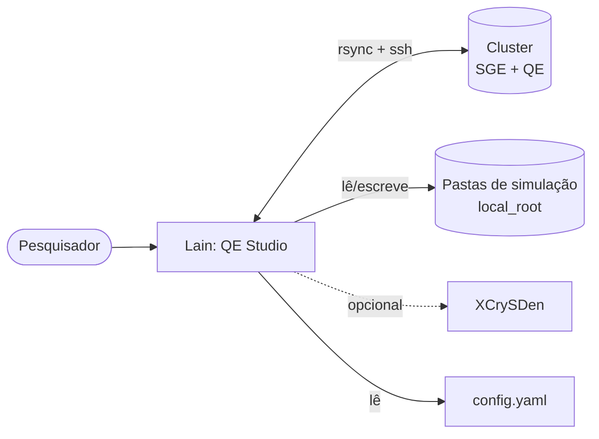
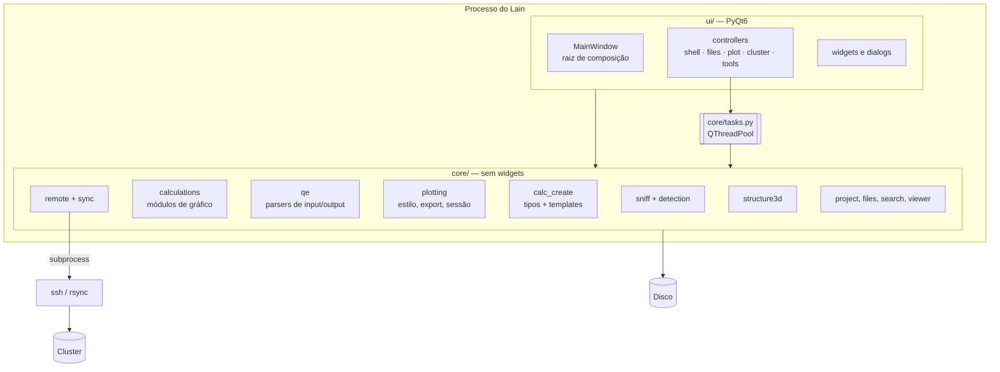

# Arquitetura — visão geral

O Lain separa **lógica** de **interface**:

- `src/qe_studio/core/` — lógica sem widgets, testável sem Qt (parsers, detecção, física, arquivos, sync, geração).
- `src/qe_studio/ui/` — app PyQt6: widgets, layout, diálogos e ligação de sinais.
- Pacote `qe_studio` (nome interno histórico) com comando `lain`.

## Contexto (nível 1)

## Contêineres (nível 2)

## Princípios

1. **A thread da GUI nunca lê nem analisa arquivos**; tudo passa por `core/tasks.py` (`run_task`, `TaskGroup`).
2. **Identificação por conteúdo**, nunca pelo nome do arquivo.
3. **Modular**: um novo gráfico ou tipo de cálculo é um módulo novo + um registro (`REGISTRY`), não um `if` numa classe
   central. A UI não conhece `kind == "bands"`.
4. **Segurança do cluster**: ssh estrito, comandos só de programas do config, prévia antes de transferir, nada apagado.
5. **Integridade dos dados**: nunca sobrescreve arquivo do usuário sem perguntar; escrita atômica.

## Páginas

| Página | Conteúdo |
|---|---|
| [Camadas e regras](layers.md) | áreas de `core/` e `ui/`, regras verificadas por teste |
| [Detecção](detection.md) | `sniff` → `FileRole` → módulos |
| [Módulos de cálculo](calc-modules.md) | UML dos módulos de gráfico |
| [Criar cálculo](create-calc.md) | UML dos tipos e pipeline de geração |
| [Threading](threading.md) | tarefas, cancelamento, matplotlib |
| [Sync e cluster](sync-cluster.md) | componentes do backend remoto |
| [Estado e persistência](state.md) | onde cada dado vive |
| [Composição da UI](ui-composition.md) | `MainWindow`, controllers, ações, fechamento |
