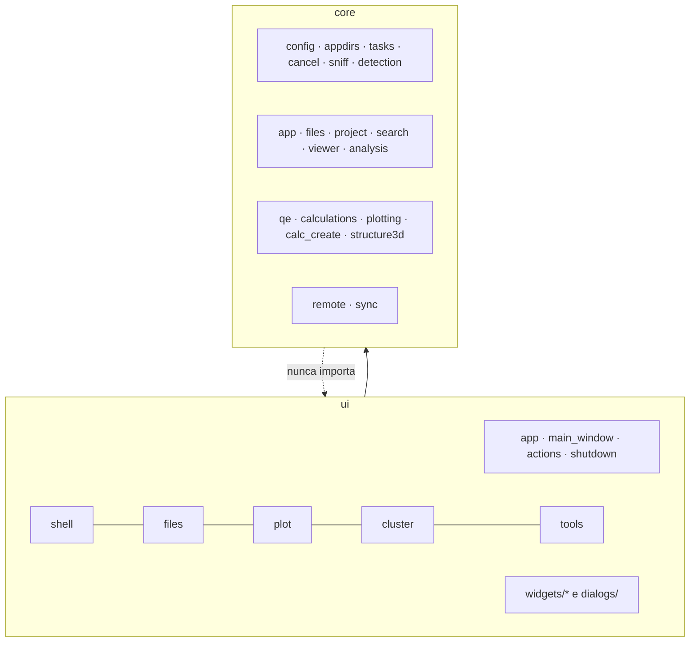

# Camadas e regras

## Áreas de `core/`

| Área | O que guarda |
|---|---|
| (topo) | `config`, `config_template`, `appdirs`, `tasks`, `cancel`, `sniff`, `detection` |
| `app` | idioma na partida, "Sobre", cores, escala de fonte, log |
| `files` | tipos de arquivo, regras de pasta, operações, programas externos |
| `project` | o que `.lain/` guarda (projetos, grids, compostos, favoritos) |
| `search` | paleta de comandos (índice de pastas, busca difusa) |
| `viewer` | visualizador de texto |
| `analysis` | somas sobre resultados (energia de adsorção) |
| `qe` | parsers/edição de inputs e saídas do QE |
| `calculations` | módulos de gráfico |
| `plotting` | estilo, exportação, sessão, grids |
| `calc_create` | tipos e templates do "Criar cálculo" |
| `structure3d` | modelo 3D, ligações, câmera, medidas |
| `remote`, `sync` | cluster |

## Áreas de `ui/`

No topo só `app`, `main_window`, `actions`, `shutdown`. Um controller vai em `ui/<área>/` e seus widgets em
`ui/widgets/<área>/`: `shell` (janela, idioma, layout, ajuda, paleta), `files`, `plot`, `cluster`, `tools`. Diálogos em
`ui/dialogs/`; o visualizador de texto em `ui/widgets/viewer/`.

## Regras checadas por `tests/test_architecture.py`

- Nenhum arquivo passa de **500 linhas** (`main_window.py` de 450).
- `core/` nunca importa `qe_studio.ui`. PyQt6 em `core/` só em `sync/_process.py`, `sync/controller.py`,
  `sync/monitor.py` e `tasks.py`.
- `ui/` só tem lógica de interface: não abre arquivos (`open(`, `read_text`, `loadtxt`…); chamadas de disco
  (`exists`, `stat`, `iterdir`…) são contadas por arquivo e só podem diminuir.
- Módulos no topo de `core/`, `ui/` e `ui/widgets/` só os listados em `TOP_LEVEL`.
