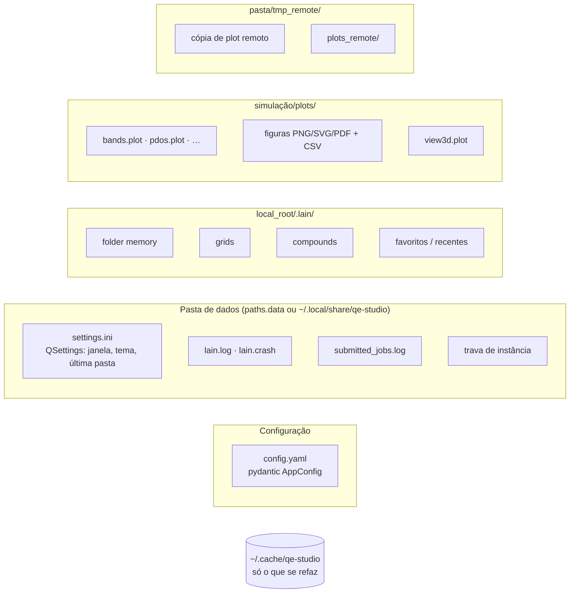

# Estado e persistência

| Dado | Onde | Quem escreve |
|---|---|---|
| Config | `config.yaml` | o usuário (somente leitura para o Lain) |
| Estado da UI | QSettings (`<data>/settings.ini`) | `ui/*` |
| Dados por raiz | `<local_root>/.lain/` (`core/project/project_data.py` é o único que cita a pasta) | `core/project/*` |
| Ajustes e exportações | `<simulação>/plots/` | `core/plotting/*` |
| Cópia de plot remoto | `<pasta>/tmp_remote/` | `core/remote/scratch.py` (sobrescreve sem perguntar, só aqui) |
| Jobs enviados | `<data>/submitted_jobs.log` | `core/remote/submit_log.py` |
| Log | `<data>/lain.log` | `core/app/logs.py` |
| Estilos de gráfico | `resources/templates/plot_styles/*.yaml` | só leitura |

- **Integridade**: nunca sobrescrever arquivo do usuário sem perguntar (`core/files/unique_names.py`: sufixos `_2`);
  arquivos de dados são escritos inteiros com `core/appdirs.py:atomic_write_text`.
- Nada mais é gravado em pastas de simulação.
- O idioma não influencia nada que persiste (`.lain/`, `.plot`, exportações, QSettings) — verificado por teste.
