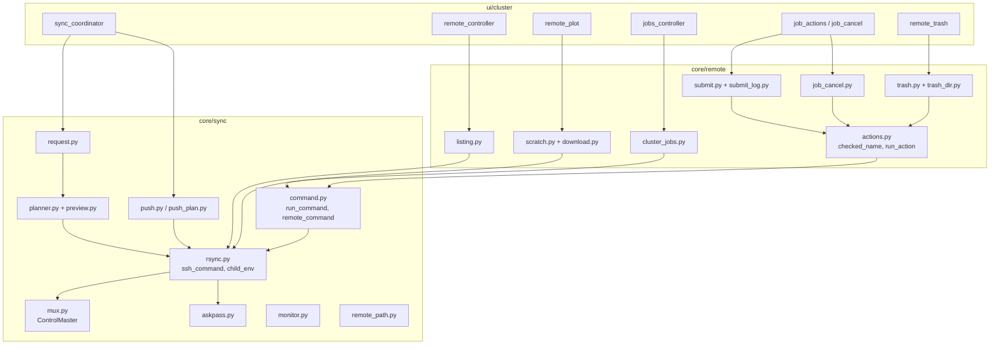
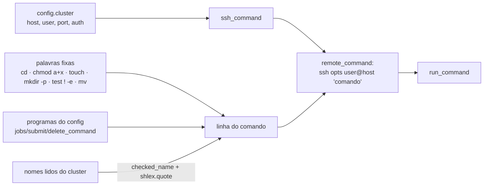

# Sync e cluster (componentes)

## Papéis

| Módulo | Responsabilidade |
|---|---|
| `core/sync/rsync.py` | **único** lugar que monta opções do ssh (`ssh_command`) e o ambiente do filho (`child_env`); argumentos do rsync |
| `core/sync/command.py` | roda um comando remoto (`remote_command`), com timeout e cancelamento, sem stdin nem terminal |
| `core/sync/mux.py` | conexão compartilhada (`ControlMaster=auto`, `ControlPersist=120`, `ControlPath` curto e `0700`) |
| `core/sync/askpass.py` | helper `SSH_ASKPASS` (`qe-studio-askpass`) |
| `core/sync/planner.py`, `preview.py` | *dry run* do rsync → plano → prévia |
| `core/sync/push.py`, `push_plan.py` | envio só de arquivos novos |
| `core/sync/monitor.py` | sonda de alcance (LED) |
| `core/remote/actions.py` | validação (`checked_name`, `checked_dir`), execução, classificação de falhas |
| `core/remote/listing.py` | `rsync --list-only` |
| `core/remote/submit.py`, `job_cancel.py`, `trash.py` | os três comandos que alteram o cluster |
| `core/remote/scratch.py`, `download.py` | cópia para `tmp_remote/` |

## Classificação de falhas

`classify_failure` distingue: tempo esgotado (`connection`), autenticação recusada (`auth`), comando não encontrado
(`missing`, código 127), cluster inacessível (`connection`) e erro do próprio comando — cada um com uma mensagem
própria e, quando é o caso, a sugestão de usar o caminho completo do programa.

## Composição de um comando remoto

