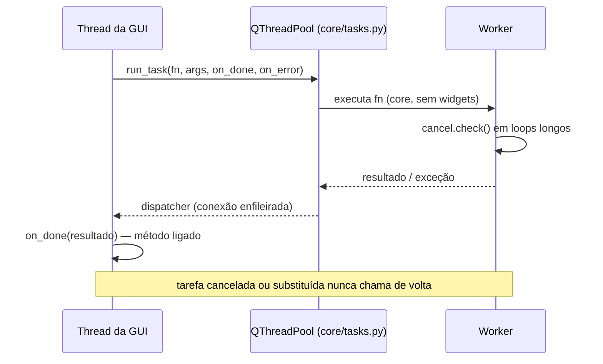

# Threading

- **A GUI nunca lê nem analisa arquivos.** Toda tarefa de fundo passa por `core/tasks.py` (`run_task`, `TaskGroup`).
  `TaskGroup` indexa tarefas por chave: uma nova para a mesma chave substitui a anterior, cujo resultado é descartado.
- **Cancelamento cooperativo**: um loop longo em `core/` chama `core/cancel.py:check()`; `run_command` mata o
  processo filho (ssh/rsync) e levanta `Cancelled`.
- **Callbacks** são métodos ligados; se o receptor é um `QObject`, só uma referência fraca é mantida e a destruição
  cancela a tarefa.
- **Pools privados** não têm pai Qt (evita *deadlock* no destrutor C++ com o GIL). Quem os possui chama
  `TaskGroup.shutdown` ao fechar.
- **matplotlib** tem estado global: `core/plotting/mpl_lock.py:MPL_LOCK` serializa; a GUI só *tenta* o lock.
- Exceção: `core/sync/monitor.py` sonda em threads *daemon* (um DNS pode bloquear além do timeout).
- Fechamento: `ui/shutdown.py` — um job novo entra nos passos de encerramento, respeita o tempo dado e informa se
  terminou.
