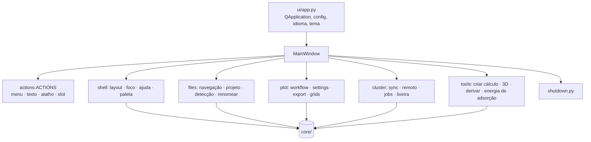

# Composição da UI

`ui/main_window.py:MainWindow` é a **raiz de composição**: constrói widgets, controllers e stores, mantém só o que
atravessa controllers e uma fachada fina usada por testes e por `scripts/screenshot.py`.

- **Um recurso novo** ganha o próprio controller, criado por uma fábrica `for_window(window)`.
- **Ações de janela**: `ui/actions.py:ACTIONS` (id estável, menu, texto, atalho, caminho do slot). Teclas que um widget
  trata sozinho vão em `shortcut_help()`.
- **Fechamento**: `ui/shutdown.py`. O controller de um diálogo não modal implementa `close_dialog() -> bool`.
- **Diálogos** usam `WA_DeleteOnClose`, exceto um `exec()` modal cuja resposta é lida depois.
- **Sinais de longa vida** ligam a métodos, não a *lambdas*.
- **Tema**: QSS modular em `ui/resources/styles/<domínio>/*.qss` com `${token}` de `ui/resources/themes/{dark,light}.yaml`.
- **Tamanhos** que contêm texto vêm da escala de fonte (`core/app/fontscale.py`, `ui/theme/scale.py`).
- **Idioma**: textos em português dentro de `_()`; o inglês vem de `locale/en/LC_MESSAGES/lain.po`.
