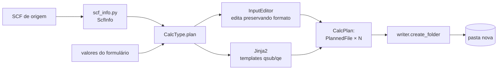

# Criar cálculo — visão geral

**Criar cálculo…** (barra lateral ou menu *Ferramentas*) gera uma **pasta nova** com os inputs do QE e o script
`.qsub` do cluster, a partir de um **SCF que você já tem**. Nada é executado: você revisa, edita, envia e submete.

## Tipos

| Tipo | Gera | Página |
|---|---|---|
| SCF | `scf_<prefix>.in` + `scf.qsub` | [SCF](scf.md) |
| Relaxamento | `relax_<prefix>.in` ou `vc-relax_<prefix>.in` + `relax.qsub` | [Relaxamento](relax.md) |
| Bandas | SCF, `bands.in`, `bands_pp*.in`, `bands.qsub` | [Bandas](bands.md) |
| PDOS | SCF, NSCF, `projwfc.in`, `pdos.qsub` | [PDOS](pdos.md) |
| Carga | SCF + `pp_<nome>_charge.in` | [Carga](charge.md) |
| Diferença de carga | 3 SCFs + 4 `pp.x` | [Diferença de carga](charge-diff.md) |
| Slab | `relax_*.in` do slab (ou `vc-relax_*.in`) + `geracao.md` | [Slab](slab.md) |
| Supercélula | `relax_*.in` repetido (bulk: `vc-relax_*.in`) + `geracao.md` | [Supercélula](supercell.md) |
| Molécula na superfície | `relax_*.in` do complexo + `geracao.md` | [Adsorção](adsorption.md) |
| Energia de adsorção | cópias de N SCFs + `ads_energy.qsub` | [Energia de adsorção](adsorption-energy.md) |

## Duas etapas

1. **Etapa 1 — origem e tipo**: escolha o tipo, o(s) SCF de origem, o local e o nome/sufixo da pasta. O Lain extrai
   do SCF (`core/calc_create/scf_info.py`) a estrutura, cutoffs, malha k etc. e pode mostrar uma prévia 3D.
2. **Etapa 2 — revisão**: o formulário do tipo e **uma aba por arquivo** a gerar (script, inputs, `Descrição` em
   Markdown). A prévia atualiza enquanto você edita; os problemas do input aparecem como no visualizador.

## Modos

- **Padrão**: só os campos essenciais; o resto assume o padrão validado.
- **Avançado**: todos os campos e os nomes de cada arquivo. Inputs e scripts podem ser editados à mão.

## Regras

- A pasta é nova: `<número>_<Tipo>[_sufixo]` (veja [numeração](../folders.md#numeracao-das-pastas-do-criar-calculo)); uma pasta
  que existe nunca é sobrescrita.
- `jobs.cores` (NP), `jobs.pseudo_dir` e `jobs.myemail` do `config.yaml` definem os padrões do script.
  Um input com `K_POINTS gamma` (ou sem o card) com `nk` maior que 1 recebe um aviso: o `pw.x` para com pools nesse caso.
- **Pools (`nk`)**: o campo (modo Avançado) abre preenchido com o valor que o Lain calcula e você pode trocá-lo;
  apagado, volta ao calculado. O valor segue o NP e os k-points irredutíveis dos inputs do `pw.x` (pela simetria da
  estrutura que vai no input; com `nspin = 2` contam os dois spins; vale o input com menos k-points): `nk` é múltiplo
  de 4, no máximo 16, divide o NP e deixa ao menos 4 núcleos por pool, e escolhe o maior em que nenhum pool fica mais de
  20 % ocioso. Com um só k-point (`gamma`) vale 1. Com NP = 64 ou 128: 10 k-points dão `nk = 4`, 36 dão 8, 47 dão 16.
  Um `nk` com mais pools que k-points, ou fora de múltiplos de 4 até 16, recebe um aviso.
- **Gerar fingerprint.md** (desligado por padrão, lembrado): registra tipo, nome final, hora, versão do Lain e SCFs de
  origem.
- Todo script segue o modelo atual do cluster (SGE + Intel MPI), em `resources/templates/qsub/`.
- **Cada passo é conferido** (`check_step`, uma linha depois de cada programa): o status, o `JOB DONE`
  no fim da saída e as mensagens com que o `pw.x` para antes de terminar (SCF sem convergência, `.EXIT`, `max_seconds`,
  relax que chega ao `nstep` ou com BFGS falho; o `pw.x` sai com status 0 e `JOB DONE` também nesses casos). No primeiro
  passo que falha, o job termina sem rodar os seguintes, o e-mail chega como `Job failed: <saída>` e o log `.o` ganha a
  linha `Job failed: …`, por isso o Lain o marca como erro.

## O que há por trás

Detalhes e UML em [Arquitetura ▸ Criar cálculo](../architecture/create-calc.md).
