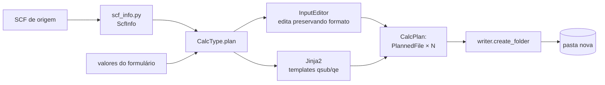

# Criar cálculo — visão geral

**Criar cálculo…** (barra lateral ou menu *Ferramentas*) gera uma **pasta nova** com os inputs do QE e o script
`.qsub` do cluster, a partir de um **SCF que você já tem**. Nada é executado: você revisa, edita, envia e submete.

## Tipos

| Tipo | Gera | Página |
|---|---|---|
| SCF | `scf_<prefix>.in` + `scf.qsub` | [SCF](scf.md) |
| Relax | `relax_<prefix>.in` + `relax.qsub` | [Relax](relax.md) |
| VC-Relax | `vc-relax_<prefix>.in` + `vc-relax.qsub` | [VC-Relax](vc-relax.md) |
| Bandas | SCF, `bands.in`, `bands_pp*.in`, `bands.qsub` | [Bandas](bands.md) |
| PDOS | SCF, NSCF, `projwfc.in`, `pdos.qsub` | [PDOS](pdos.md) |
| Carga | SCF + `pp_<nome>_charge.in` | [Carga](charge.md) |
| Diferença de carga | 3 SCFs + 4 `pp.x` | [Diferença de carga](charge-diff.md) |
| Slab | `vc-relax_*.in` do slab + `geracao.md` | [Slab](slab.md) |
| Supercélula | `vc-relax_*.in` repetido + `geracao.md` | [Supercélula](supercell.md) |
| Molécula na superfície | `relax_*.in` do complexo + `geracao.md` | [Adsorção](adsorption.md) |
| Energia de adsorção | cópias de N SCFs + `ads_energy.qsub` | [Energia de adsorção](adsorption-energy.md) |

## Duas etapas

1. **Etapa 1 — origem e tipo**: escolha o tipo, o(s) SCF de origem, o local e o nome/sufixo da pasta. O Lain extrai
   do SCF (`core/calc_create/scf_info.py`) a estrutura, cutoffs, malha k etc. e pode mostrar uma prévia 3D.
2. **Etapa 2 — revisão**: o formulário do tipo e **uma aba por arquivo** a gerar (script, inputs, `Descrição` em
   Markdown). A prévia atualiza enquanto você edita; erros de escrita aparecem como no visualizador.

## Modos

- **Padrão**: só os campos essenciais; o resto assume o padrão validado.
- **Avançado**: todos os campos e os nomes de cada arquivo. Inputs e scripts podem ser editados à mão.

## Regras

- A pasta é nova: `<número>_<Tipo>[_sufixo]` (veja [numeração](../folders.md#numeracao-das-pastas-do-criar-calculo)); uma pasta
  que existe nunca é sobrescrita.
- `jobs.cores` (NP), `jobs.nk`, `jobs.pseudo_dir` e `jobs.myemail` do `config.yaml` definem os padrões do script.
- **Gerar fingerprint.md** (desligado por padrão, lembrado): registra tipo, nome final, hora, versão do Lain e SCFs de
  origem.
- Todo script segue o modelo atual do cluster (SGE + Intel MPI), em `resources/templates/qsub/`.

## O que há por trás

Detalhes e UML em [Arquitetura ▸ Criar cálculo](../architecture/create-calc.md).
