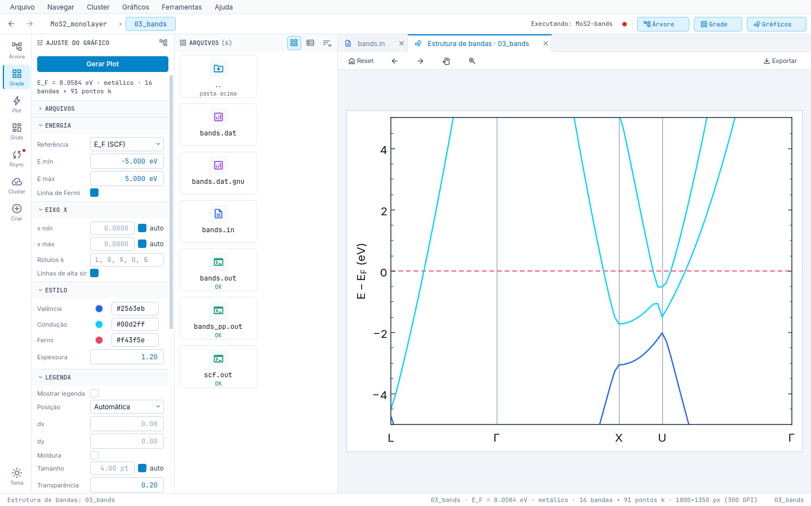

# Aparência e idioma

- **Tema**: `dark`, `light` ou `system` (`ui.theme`); `Ctrl+T` alterna e lembra. QSS modular com *tokens* de cor em
  `ui/resources/themes/{dark,light}.yaml`, todos validados em contraste WCAG AA.
- **Fonte**: `ui.font_scale` de 0,8 a 1,6 (tudo que contém texto escala). Inter e JetBrains Mono embutidas.
- **Acessibilidade**: foco visível, ordem de `Tab` e `Ctrl+1..4`.
- **Idioma**: `ui.language` = `auto` | `pt_BR` | `en` (aplica ao iniciar). `auto` usa português para `pt*` e inglês nos
  demais. Variáveis `QE_STUDIO_LANGUAGE` / `LAIN_LANGUAGE` têm precedência.
- **Figuras** não seguem o tema do app: o fundo vem dos parâmetros/estilo (padrão branco), para que a prévia e a
  exportação sejam iguais.

