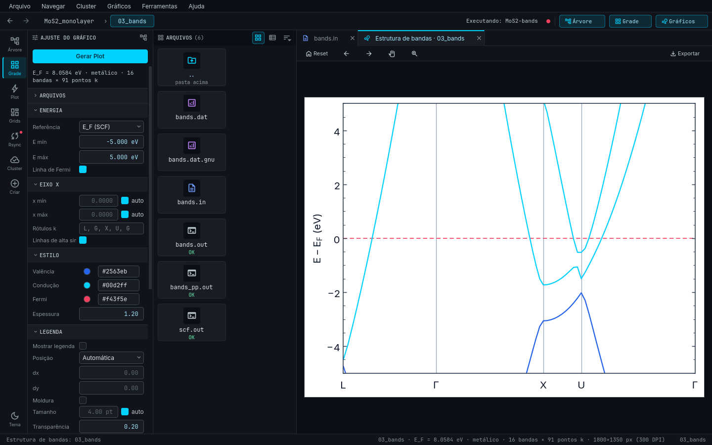

# Lain: QE Studio

**Lain: QE Studio** é um aplicativo de desktop (PyQt6) para **navegar, sincronizar e plotar** simulações do
[Quantum ESPRESSO](https://www.quantum-espresso.org/) (QE **7.1 ou mais novo**), e para **gerar novos cálculos**
(inputs do `pw.x`, `bands.x`, `projwfc.x`, `pp.x` e scripts `.qsub`) a partir de um SCF que você já tem.

## O que ele faz

- **Detecta** o tipo de cada pasta (SCF, relax, bandas, PDOS…) pelo **conteúdo** dos arquivos, nunca pelo nome.
- **Plota** bandas, PDOS, bandas + DOS, relax/vc-relax e convergência do SCF, com painel de ajustes e exportação
  PNG/SVG/PDF (+ CSV).
- **Cria cálculos** ("Criar cálculo"): SCF, Relax, VC-Relax, Bandas, PDOS, Carga, Diferença de carga, Slab,
  Supercélula, Molécula na superfície e Energia de adsorção.
- **Sincroniza** com o cluster via `rsync` + `ssh` (sempre com prévia) e tem um **modo cluster** que lista,
  plota, submete, cancela e move para a lixeira direto no cluster.
- Mostra a **estrutura em 3D**, com medidas de distância e ângulo.

## Mapa da documentação

| Quero… | Vá para |
|---|---|
| Instalar e abrir | [Instalação](installation.md), [Início rápido](quickstart.md) |
| Configurar o `config.yaml` | [Configuração](config.md) |
| Organizar minhas pastas | [Organização de pastas](folders.md), [Fluxo de trabalho](workflow.md) |
| Entender cada recurso | [Funcionalidades](features/index.md) |
| Plotar | [Gráficos](plots/index.md) |
| Gerar inputs e `.qsub` | [Criar cálculo](create-calc/index.md) |
| Conectar ao cluster | [Conexão SSH](ssh.md), [Modo remoto](remote-mode.md) |
| Entender ou alterar o código | [Arquitetura](architecture/index.md), [Mapa do código](code-map.md) |
| Resolver um problema | [Solução de problemas](troubleshooting.md), [Glossário](glossary.md) |

!!! note "Idioma"
    A interface do Lain tem português e inglês (`ui.language`). Esta documentação cita os nomes de menus e botões
    como aparecem em português, com o equivalente em inglês no [glossário](glossary.md).
