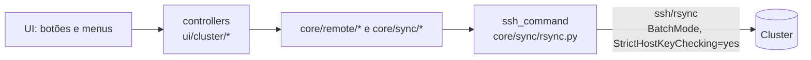
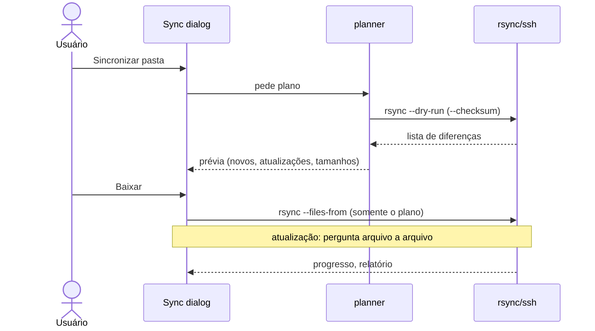
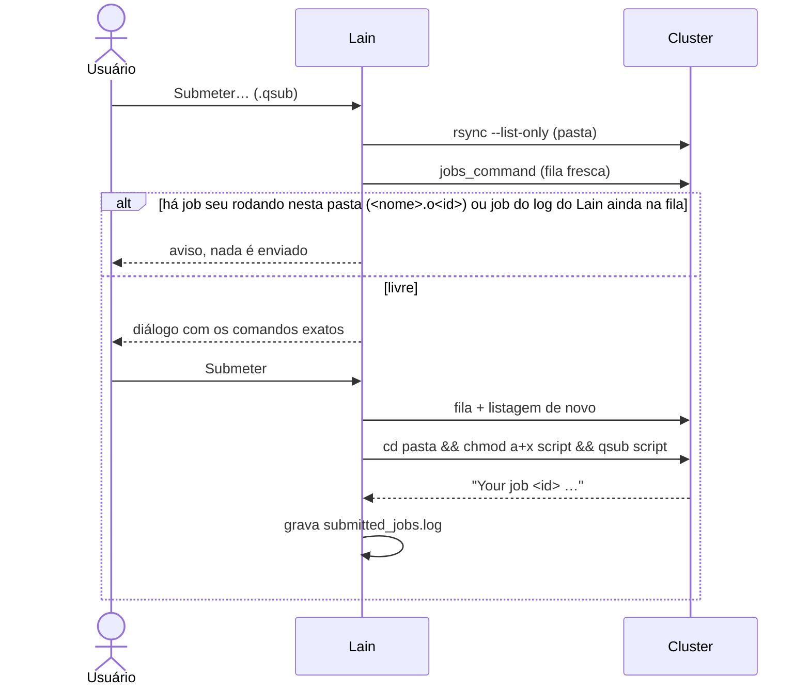
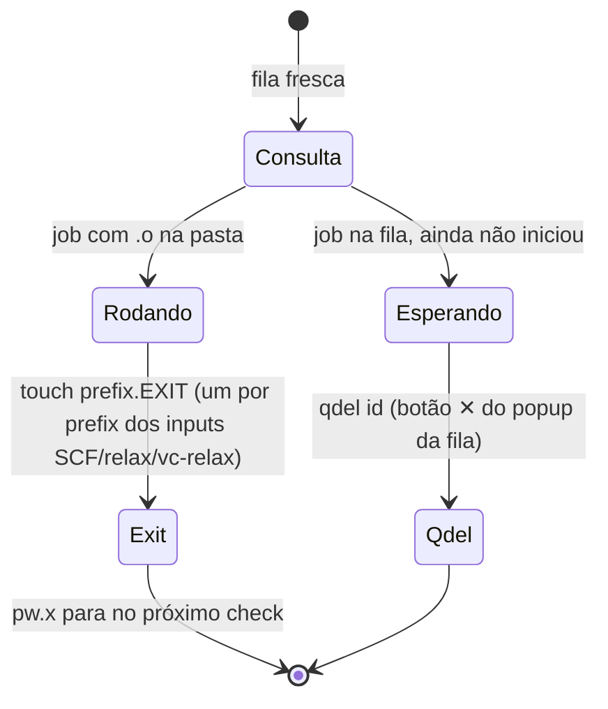

# Modo remoto e comandos no cluster

O Lain nunca roda código dele no cluster: ele monta **linhas de comando fixas** e as executa por `ssh`/`rsync`, com
as mesmas opções e o mesmo login. Esta página mostra exatamente o que é executado.

## Visão geral

Toda chamada passa por `core/sync/rsync.py:ssh_command` (opções do ssh) e roda em **thread de fundo**
(`core/tasks.py`). Comandos que **alteram** o cluster só rodam depois de um diálogo de confirmação que mostra o
comando exato.

## Catálogo de comandos

| Ação | O que roda | Código |
|---|---|---|
| Testar conexão | sonda TCP (sem login) | `core/sync/monitor.py` |
| Listar pasta (modo cluster) | `rsync --list-only` | `core/remote/listing.py` |
| Fila de jobs | `cluster.jobs_command` (ex.: `qstatus -a`) | `core/remote/cluster_jobs.py` |
| Baixar (pull) | `rsync` com **dry run** + prévia + cópia | `core/sync/planner.py`, `rsync.py` |
| Enviar (push) | `rsync --ignore-existing` (só arquivos novos) | `core/sync/push*.py` |
| Plotar remoto | `rsync` da pasta para `tmp_remote/` | `core/remote/scratch.py`, `download.py` |
| Submeter `.qsub` | `cd <pasta> && chmod a+x <script> && qsub <script>` | `core/remote/submit.py` |
| Cancelar job rodando | `touch <pasta>/<prefix>.EXIT` (um por prefix) | `core/remote/job_cancel.py` |
| Cancelar job em espera | `qdel <job-id>` | `core/remote/job_cancel.py` |
| Apagar (mover) | `cd <root> && mkdir -p … && test ! -e <alvo> && mv <item> <alvo>` | `core/remote/trash.py` |

Os únicos programas que não são palavras fixas vêm do `config.yaml`: `jobs_command`, `submit_command`,
`delete_command`. Nomes lidos do cluster (arquivo, pasta, prefix, job-id) entram **só como argumento**, depois de
`checked_name` (letras, dígitos, `.`, `_`, `+`, `-`) e `shlex.quote`.

## Sincronização (pull)

- Regra: arquivo só no cluster → baixa; cópia do cluster mais nova ou conteúdo diferente → você escolhe
  (sobrescrever este / todos da pasta / manter local / cancelar); local mais novo → mantido.
- rsync roda com `LC_ALL=C.UTF-8`, `TZ=UTC` e `--no-h` (a saída é analisada) e `--exclude` de `sync.exclude`.
- `.lain/`, `tmp_remote/` e (na raiz) `trash/` são exclusões fixas.

## Envio (push)

Sempre com prévia. Só adiciona arquivos que o cluster **não tem** (`--ignore-existing`); nunca sobrescreve nem apaga,
nunca envia para `trash/`, e `push_exclude` (`plots/`, `*.plot`) fica de fora.

## Modo cluster

O botão **Cluster** troca árvore e grade pelos arquivos remotos (fundo vermelho). Listagens ficam em memória por
sessão e são refeitas em segundo plano após 60 s. Menu de contexto:

- **Baixar** — o pull comum, com prévia.
- **Plotar** — copia a pasta (menos `sync.exclude`) para `tmp_remote/` local e plota de lá; cada plot novo sobrescreve
  a cópia **sem perguntar** (só ali). Prévia só se algum arquivo passa de 100 MB.
- **Submeter…** — veja abaixo.
- **Cancelar simulação…** — veja abaixo.
- **Apagar…** — move para a lixeira, não apaga.

### Submeter

Se um job seu com o mesmo `#$ -N` já roda ou espera em qualquer lugar, um diálogo pergunta antes ("Voltar" é o padrão).
O `submitted_jobs.log` (na pasta de dados) lembra jobs enviados pelo Lain ainda na fila.

### Cancelar

Nunca por palpite: uma **fila fresca** logo antes de agir decide.

Job **rodando** só é parado criando `<prefix>.EXIT` (regra do administrador do cluster); `qdel` só vale para job
**em espera**, pelo ID. Os próximos comandos do script ainda rodam (nscf, bands.x, projwfc.x…).

### Apagar (lixeira)

`<root>/projeto/PDOS` vira `trash/projeto/PDOS_2026-10-30_14-02-11/`. Bloqueado se há job seu rodando na pasta (ou
abaixo), ou job enviado pelo Lain ainda na fila; nenhum sync começa até o fim do `mv`. O Lain **nunca** apaga de
verdade: esvazie `trash/` num terminal do cluster.

## Segurança em resumo

- Chave de host desconhecida é sempre recusada (`StrictHostKeyChecking=yes` forçado).
- Senha só por `SSH_ASKPASS`; nunca em argv ou log.
- Push não sobrescreve; pull passa por dry run e prévia.
- O cluster é produção: **nenhum teste** do projeto o alcança (testes usam um servidor SSH local de `paramiko`).
