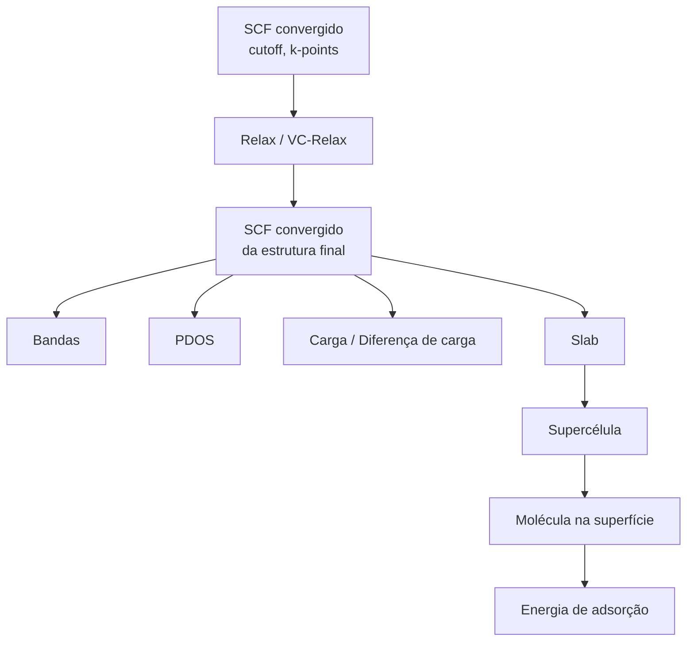
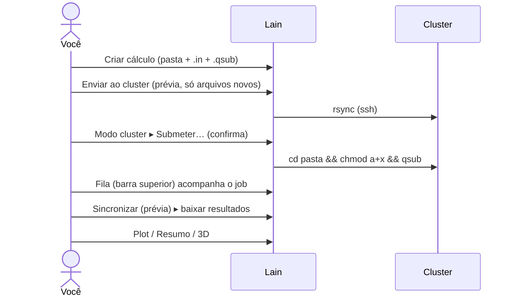

# Fluxo de trabalho recomendado

## Ordem sugerida

1. **SCF** com cutoffs e malha k testados. É a base: quase todo tipo do "Criar cálculo" parte de um SCF.
2. **Relax** (posições) ou **VC-Relax** (posições + célula). Acompanhe `|ΔE|` e força no [gráfico de relax](plots/relax.md).
3. **SCF convergido**: do menu de contexto da saída de um relax/vc-relax convergido, "Gerar SCF convergido" cria o `.in`
   com a estrutura final.
4. A partir do SCF final:
    - **Bandas** (pw.x `bands` + `bands.x`) — [gráfico](plots/bands.md);
    - **PDOS** (NSCF + `projwfc.x`) — [gráfico](plots/pdos.md); junte os dois em **Bandas com DOS**;
    - **Carga** / **Diferença de carga** (`pp.x`) para ver em XCrySDen.
5. **Superfícies**: Slab (abre vácuo) → Supercélula (repete a célula) → Molécula na superfície → rode os SCFs e
   calcule a [energia de adsorção](features/adsorption-energy.md).

## Ciclo diário

!!! tip "Nunca pule o SCF"
    Bandas, PDOS e carga leem a energia de Fermi e a estrutura do SCF. Mantenha o SCF por perto: o Lain o procura em
    pastas irmãs `*scf*`.
